# Palimpsesto

**Una nueva mirada. La misma pieza.** Asistente local de procesamiento digital de imágenes que convierte la foto de celular de un manuscrito, un documento impreso o una pintura plana en una copia frontal y legible, sin perder el control humano sobre cada paso.

Proyecto final de **Procesamiento Digital de Imágenes** · Universidad Autónoma de Occidente · Profesor Nicolás Llanos Neuta
Equipo: **David Neira Conde · Juan Sebastián Gómez Muñoz · Juan Felipe Fajardo Valencia**
Macroproyecto: *Análisis de la Expresión Humana en el Arte y la Cultura* (línea de patrimonio cultural, obras de arte y museos).

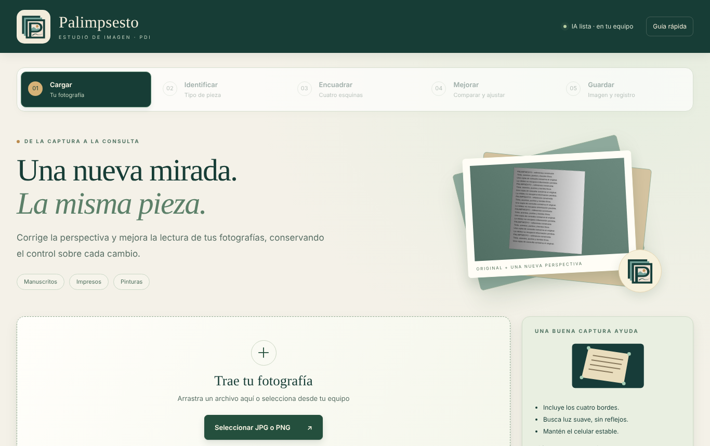

| Sección de la rúbrica | Dónde está |
|---|---|
| Descripción del proyecto | [1. Descripción](#1-descripción-del-proyecto) |
| Arquitectura del sistema | [2. Arquitectura](#2-arquitectura-del-sistema) |
| Metodología | [3. Metodología](#3-metodología) |
| Implementación | [4. Implementación](#4-implementación) |
| Datos | [5. Datos](#5-datos) |
| Interfaz gráfica de usuario | [6. Interfaz](#6-interfaz-gráfica-de-usuario) |
| Resultados | [7. Resultados](#7-resultados) |
| Conclusiones | [8. Conclusiones](#8-conclusiones) |
| Instalación y ejecución | [9. Instalación](#9-instalación-y-ejecución) |

---

## 1. Descripción del proyecto

### Problemática

Gran parte del patrimonio documental y artístico (manuscritos, cartas, diplomas, pinturas) circula únicamente en fotografías que visitantes, estudiantes e investigadores toman con su celular en archivos, bibliotecas y museos. Esas capturas rara vez cumplen las condiciones de una digitalización profesional: la pieza aparece torcida, con distorsión de perspectiva, iluminación desigual, sombras, reflejos o desenfoque, lo que dificulta leerla, archivarla y analizarla después (Liang et al., 2005).

**Escenario de uso.** Una investigadora en historia consulta manuscritos en la sala de un archivo. No tiene escáner: solo su celular, sin trípode ni luz controlada, y un horario de consulta limitado. Con frecuencia descubre días después, en su computador, que parte del texto no se lee; corregirlo implica volver al archivo, pedir la pieza otra vez y manipular un original que la conservación busca proteger.

**Pregunta guía:** ¿cómo corregir la perspectiva y mejorar la legibilidad de una fotografía imperfecta de una pieza cultural, adaptando el tratamiento al tipo de pieza y permitiendo que el usuario lo supervise, mediante procesamiento digital de imágenes y redes neuronales convolucionales?

### Justificación

- La UNESCO (2003) reconoce como patrimonio digital los recursos que se convierten a formato digital a partir de material analógico y llama a conservarlos. Una captura ilegible no sirve para citar la fuente ni para incorporarla a un archivo digital.
- **Un mismo tratamiento no sirve para todo:** binarizar un manuscrito puede borrar trazos débiles, y "mejorar" el color de una pintura altera la obra. Por eso una red identifica el tipo de pieza y ese tipo define el tratamiento inicial.
- **La persona que conoce la pieza debe decidir.** Una imagen "bonita" no garantiza fidelidad documental; el sistema propone y el usuario confirma, corrige o rechaza en cada etapa.
- **Valor práctico:** permite descubrir *antes de salir de la sala* que la foto no sirve y repetirla mientras la pieza sigue sobre la mesa.

### Objetivos

**General.** Desarrollar un sistema interactivo de procesamiento digital de imágenes y aprendizaje profundo que, a partir de una fotografía imperfecta de una pieza de valor cultural, identifique su tipo, corrija su perspectiva y mejore su iluminación y nitidez, permitiendo al usuario supervisar y ajustar cada etapa, para producir una imagen legible y apta para el archivo digital.

**Objetivos específicos del prototipo y estado**

| Objetivo específico | Estado en esta versión |
|---|---|
| 1. Construir un conjunto de imágenes reales de celular y versiones con distorsión sintética, e implementar la corrección geométrica (esquinas + homografía). | ✅ 480 fotos reales etiquetadas; perturbaciones y referencias sintéticas; U-Net + contornos + borde manual; homografía sobre RGB original. |
| 2. Diseñar, entrenar y validar una CNN que clasifique la pieza (manuscrito, impreso, pintura) controlando el sobreajuste con *data augmentation*, Dropout y L2; implementar la mejora con preajuste por clase y conservando el color en pinturas. | ✅ CNN del curso con 5 variantes (base, Dropout, L2, aumentos, combinada) + ANN de descriptores; clasificador operativo por transferencia (ResNet18); preajustes por clase; pinturas sin binarización. |
| 3. Integrar los módulos en un prototipo web interactivo y evaluar el sistema mediante datos reales, métricas cuantitativas y pruebas de funcionamiento. | ✅ Prototipo de cinco pasos; clasificación, segmentación, mejora y exportación evaluadas. |

### Solución propuesta

Palimpsesto actúa como un **restaurador digital asistido** en cinco pasos:

1. **Cargar** la foto (JPG/PNG). Se valida el archivo, se corrige la orientación EXIF y se comprueba si el contenido parece una pieza admitida.
2. **Identificar**: una CNN sugiere el tipo de pieza y el usuario lo confirma o lo cambia.
3. **Encuadrar**: una U-Net propone las cuatro esquinas; el usuario las revisa, las arrastra o las marca a mano.
4. **Mejorar**: homografía a vista frontal y mejora clásica ajustable (iluminación, CLAHE, suavizado, nitidez, binarización solo en documentos), con comparación antes/después y detalle a resolución real.
5. **Guardar**: PNG, PDF, registro JSON de todas las decisiones y un ZIP que incluye el **original byte a byte**.

> **La CNN no restaura la imagen: decide cómo debe restaurarse.** La geometría y la calidad se corrigen con técnicas clásicas de PDI vistas en el curso, y la persona supervisa cada etapa.

**Alcance.** Imágenes estáticas de una pieza plana o casi plana por foto. No transcribe texto (OCR), no reconstruye partes perdidas, no aplana páginas curvas y no certifica colorimetría patrimonial.

---

## 2. Arquitectura del sistema

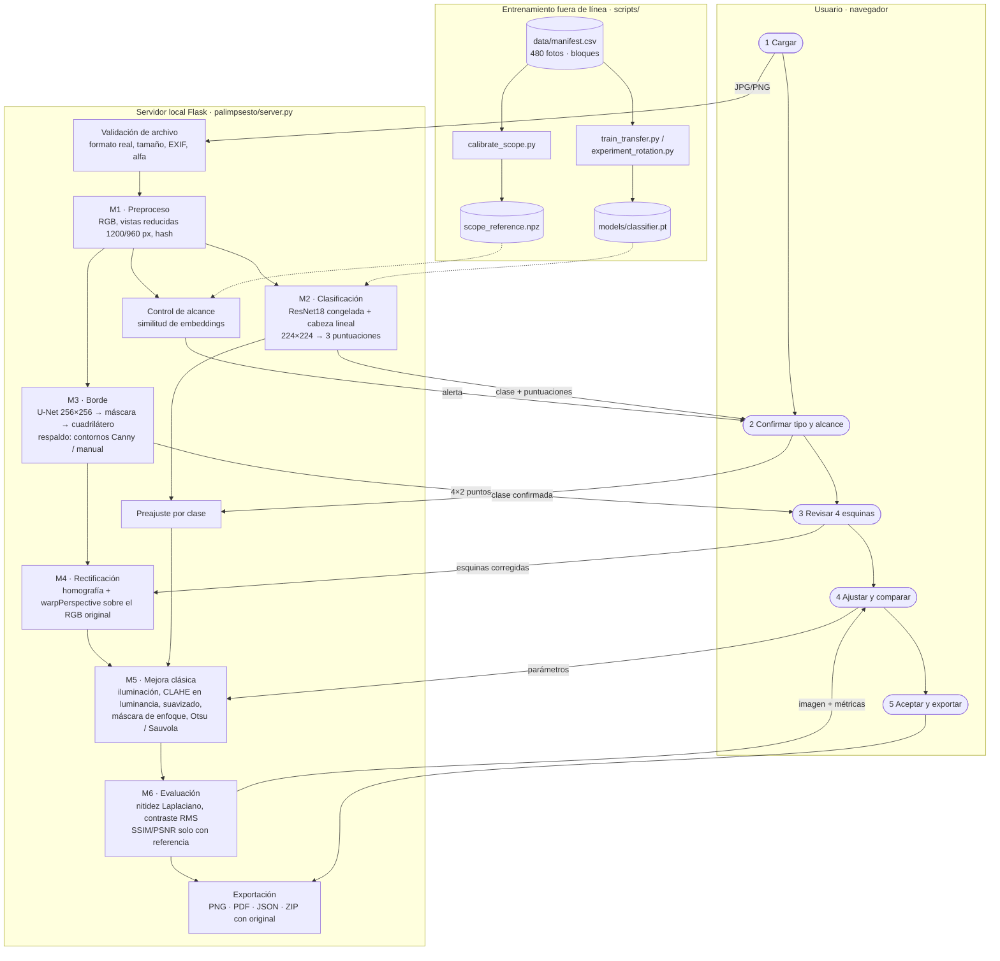

| Módulo | Entrada → salida | Técnica | Archivo |
|---|---|---|---|
| Validación | bytes → RGB uint8 | decodificación real, límites de tamaño/píxeles, EXIF, alfa sobre blanco | `palimpsesto/imaging.py` |
| M1 Preproceso | RGB → vista previa (1200 px), vista de detección (960 px), hash | redimensión INTER_AREA, SHA-256 | `imaging.py` |
| Alcance | RGB → alerta sí/no | similitud coseno con 408 embeddings de desarrollo | `palimpsesto/models.py` |
| M2 Clasificación | RGB 224×224 → 3 puntuaciones | ResNet18 ImageNet congelada + cabeza lineal | `models.py` |
| M3 Borde | RGB 256×256 → máscara → 4 puntos | U-Net (encoder ResNet18); contornos; manual | `models.py`, `imaging.py` |
| M4 Rectificación | RGB + 4 puntos → vista frontal | homografía (`getPerspectiveTransform`, `warpPerspective`) | `imaging.py` |
| M5 Mejora | vista frontal + parámetros → resultado | en el canal L de Lab: filtro bilateral, división por fondo gaussiano, CLAHE, máscara de enfoque; Otsu/Sauvola en documentos | `imaging.py` |
| M6 Evaluación | antes/después → métricas | varianza del Laplaciano, contraste RMS; SSIM/PSNR con referencia | `imaging.py` |
| Exportación | resultado + registro → archivos | PNG, PDF (ReportLab), JSON, ZIP con original | `palimpsesto/exporting.py` |
| Interfaz | — | HTML/CSS/JS sin compilación, canvas de esquinas, avisos | `templates/`, `static/` |

---

## 3. Metodología

### Etapas del desarrollo

| Fase | Qué se hizo | Evidencia |
|---|---|---|
| 1. Planeación | Problemática, escenario, alcance y arquitectura (documento de definición). | Propuesta del equipo |
| 2. Datos | 480 fotos reales con celular (160 por clase), manifiesto con hash y **bloques por pieza** para evitar fuga entre entrenamiento y prueba. | `data/manifest.csv`, `docs/DATA_CARD.md` |
| 3. Geometría | Comparación de detección clásica (Canny + contornos) frente a U-Net; homografía sobre el original. | `results/research/` |
| 4. Mejora | Comparación de técnicas en referencias sintéticas alineadas (iluminación, CLAHE, suavizado, nitidez, FFT). | `results/quality/` |
| 5. Clasificación | CNN del curso (5 variantes) y ANN de descriptores; luego transferencia ResNet18 con validación cruzada por bloques; experimento de rotación. | `results/classification/`, `results/transfer/`, `results/rotation/` |
| 6. Interfaz | Aplicación web de cinco pasos con supervisión, avisos y recuperación de errores. | `templates/`, `static/` |
| 7. Evaluación | Pruebas automáticas (Python, modelos reales, navegador) y diagnósticos de robustez y alcance. | `tests/`, `results/` |

### Técnicas de PDI y visión por computador

- **Espacio de color y geometría:** conversión RGB, orientación EXIF, homografía de cuatro puntos y remuestreo (Hartley & Zisserman, 2004).
- **Detección de bordes y contornos:** Canny (1986), morfología y aproximación poligonal como alternativa a la U-Net.
- **Segmentación:** U-Net con encoder ResNet18 entrenada en el tercer parcial (80 fotos y 80 máscaras); de su máscara se extrae el cuadrilátero.
- **Mejora (en el canal L de Lab, para no alterar el tono):** filtro bilateral contra el ruido; estimación de iluminación con filtro gaussiano grande y división; CLAHE (Zuiderveld, 1994); máscara de enfoque; binarización global de Otsu (1979) y local de Sauvola (2000) solo en documentos.
- **Frecuencia:** filtro *high-boost* con FFT, evaluado en `notebooks/Palimpsesto_experimentos.ipynb` y `results/quality/`, pero no desplegado porque no superó a los filtros espaciales.
- **Métricas:** SSIM (Wang et al., 2004) y PSNR solo cuando hay referencia alineada; nitidez (varianza del Laplaciano) y contraste RMS como descriptores, no como notas de fidelidad.

### Modelos

| Modelo | Arquitectura | Papel en el sistema |
|---|---|---|
| **CNN del curso** | 4 convoluciones (16/32/64/128) + pooling + FC 64 → 3; 5 variantes: base, Dropout, L2, aumentos, combinada | Línea base académica; se conserva con sus resultados. |
| **ANN de descriptores** | 50 descriptores (histograma RGB, bordes, nitidez) → 32 → 3 | Línea base sin convoluciones. |
| **Clasificador operativo v0.3.0** | ResNet18 ImageNet congelada + cabeza lineal (regresión logística L2) entrenada con vistas de brillo, giros de ±8° y **giros de 90°/180°/270°** | Sugiere el tipo de pieza en la interfaz. |
| **U-Net** | Encoder ResNet18, entrada 256×256 | Propone el borde de la pieza. |

**Protocolo de evaluación.** Las fotos de una misma pieza física son muy parecidas, así que dividir al azar infla los resultados. Por eso las particiones se hacen por **bloques** (41 en desarrollo y 9 en el diagnóstico) con `StratifiedGroupKFold` (5 folds, semilla 2026). Los hiperparámetros se eligen solo con validación cruzada en desarrollo. Las 72 fotos de diagnóstico ya se habían usado con la CNN del curso, así que **se reportan como diagnóstico secundario y no como prueba ciega**.

### Cambios respecto a la propuesta inicial

| Propuesta | Implementación | Motivo |
|---|---|---|
| Interfaz en Gradio | Flask + HTML/JS propios | Canvas de esquinas con arrastre y teclado, avisos accesibles y control fino de la sesión y del original. |
| CNN de 128×128 como clasificador final | La CNN del curso se conserva como línea base; el clasificador operativo es transferencia ResNet18 | La CNN propia alcanzó 52/72 (macro-F1 0,705), por debajo de la puerta de despliegue. |
| Esquinas con Canny + contornos | U-Net + contornos + manual | Con contornos, la IoU media fue 0,64; con la U-Net, 0,968 en fotos de prueba (ver Resultados). |
| Partición aleatoria 80/10/10 | Partición por bloques de pieza | Evita evaluar con fotos de la misma pieza que se usó para entrenar. |

---

## 4. Implementación

```
palimpsesto/        Núcleo del sistema
  server.py         API Flask local: carga, detección, rotación, proceso, exportación; sesiones aisladas
  imaging.py        Validación, EXIF, homografía, mejora clásica, métricas
  models.py         Carga estricta de pesos (weights_only=True), clasificación, alcance, U-Net
  exporting.py      PNG, PDF, JSON y ZIP con el original y sus hashes
templates/index.html  Interfaz de cinco pasos
static/app.js       Flujo de la interfaz (carga → identificar → encuadrar → mejorar → guardar)
static/feedback.js  Sistema de avisos: éxito, información, advertencia, error, mensajes de campo, diálogos
static/*.css        Identidad visual (papel + verde bosque), avisos y animaciones
scripts/            Entrenamiento, calibración, evaluación, figuras y verificación
tests/              Pruebas Python de contratos y acceso remoto + 22 de navegador
notebooks/          Recorrido académico con FFT y evaluación
data/manifest.csv   480 fotos, clase, bloque, partición y hash
results/            Fuente numérica de todas las cifras del README
docs/               Fichas de modelo y datos, validación, guía de sustentación
```

| Funcionalidad | Cómo se implementa |
|---|---|
| El original nunca se modifica | Se guardan sus bytes y su SHA-256; las transformaciones trabajan sobre copias y el ZIP incluye el archivo exacto. |
| Resultados que no se mezclan | Cada imagen tiene una clave y cada procesamiento una revisión; un enlace viejo o una pestaña con otra foto se rechazan. |
| Clasificación con supervisión | Si la puntuación es baja, si falta el modelo o si el contenido parece ajeno, la interfaz no impone la clase. |
| Esquinas revisables | Canvas con arrastre, selección de punto y flechas del teclado; la geometría inválida (cruzada, repetida, fuera de la foto) se rechaza. |
| Ajustes reversibles | Deshacer, mejoras en cero y comparación antes/después con la misma geometría. |
| Avisos y recuperación | `feedback.js`: avisos dentro de la ventana con icono, título y acción (Reintentar, Ir al campo, Cargar otra foto). |

---

## 5. Datos

| Conjunto | Contenido | Uso |
|---|---|---|
| **Fotos de clasificación** | 480 fotografías propias tomadas con celular, 160 por clase (impreso, manuscrito, pintura); 50 bloques provisionales de pieza | Entrenamiento y evaluación del clasificador y calibración del alcance |
| **Segmentación** | 80 fotos + 80 máscaras de documentos (18 grupos), del tercer parcial | U-Net |
| **Referencias sintéticas** | Página construida con sombra, ruido y desenfoque controlados | Comparar técnicas de mejora con SSIM/PSNR |
| **Negativos de alcance** | 10 imágenes públicas de scikit-image (gato, astronauta, monedas…) | Probar la alerta de contenido ajeno |


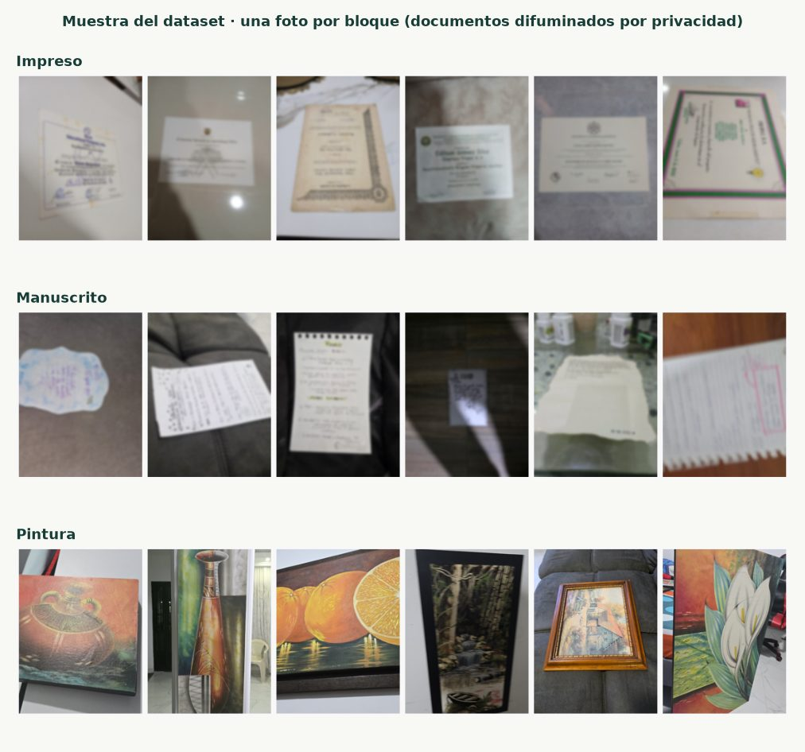

Las fotos se tomaron en contextos reales: distintos fondos, luz natural y artificial, reflejos y ángulos. Las miniaturas de documentos aparecen difuminadas porque algunos contienen nombres de personas.

**Acceso a los datos (sin invitación)**

- **Google Drive:** [480 fotos de clasificación](https://drive.google.com/drive/folders/1x-kLwxyBtguRjrFI5dU6oVQEYpr3U4Ay) y [fotos, máscaras y anotaciones de segmentación](https://drive.google.com/drive/folders/1a8JVuc3vZH-Qbuj92hRyBT6S9kvS6V3K). Son las carpetas originales de trabajo; sus etiquetas históricas train/test/val no sustituyen las particiones del manifiesto.
- **Descarga reproducible recomendada:** [dataset_palimpsesto_v1.zip · 820 MB](https://github.com/juanffff-hub/palimpsesto-pdi/releases/download/v0.3.0/dataset_palimpsesto_v1.zip). Contiene las 480 fotos del manifiesto, 80 fotos de segmentación, 80 máscaras, cinco extras y dos archivos de anotación: **647 archivos de datos**, más manifiesto, instrucciones y hashes. Se comprobaron los 480 hashes contra el manifiesto y los 647 archivos dentro del ZIP. No incluye material docente ni pesos.
- Extrae el ZIP y usa su carpeta `datos/` como `--root`. Incluye `LEEME_DATASET.txt`, `manifest.csv` y `SHA256_ARCHIVOS.json`. SHA-256 del ZIP: `1b00cb28f0490d1247b7f11874b0542dd3d73e1f3b590ef163a7768ca72d8820`.
- **Código y pesos para el docente:** [repositorio principal](https://github.com/juanffff-hub/palimpsesto-pdi) y [release v0.3.0](https://github.com/juanffff-hub/palimpsesto-pdi/releases/tag/v0.3.0). Se pueden consultar y descargar sin cuenta ni permisos de colaborador. Este es el único repositorio principal y de entrega. El material completo del curso se conserva fuera de la publicación.
- Las carpetas originales de Drive permiten actualmente editar a cualquiera con el enlace. Para una copia estable de consulta, usa el ZIP de la release; no modifiques los originales.
- `data/manifest.csv` relaciona cada foto con su clase, bloque, partición y hash. `group_verified=false` indica que **la identidad física de las piezas aún no se ha certificado**: los 50 bloques son una agrupación automática conservadora, no 50 piezas confirmadas.
- Detalle de procedencia, sesgos y licencias: `docs/DATA_CARD.md`.

---

## 6. Interfaz gráfica de usuario

### Prototipo

Antes de programar la aplicación, el flujo de cinco pasos de la Tabla 2 de la propuesta se diseñó como un **prototipo navegable** (Momento 3). Representa las pantallas, la conexión entre ellas y los estados alternativos, con datos de ejemplo y sin ejecutar ninguna función real. Se abre con doble clic en cualquier navegador: [`docs/prototipo/palimpsesto_prototipo.html`](docs/prototipo/palimpsesto_prototipo.html).

| Inicio | Tipo de pieza | Esquinas | Ajuste |
|---|---|---|---|
|  | 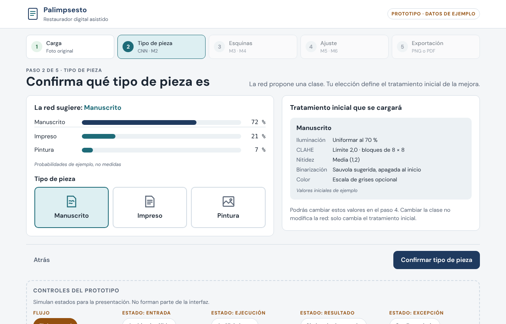 |  | 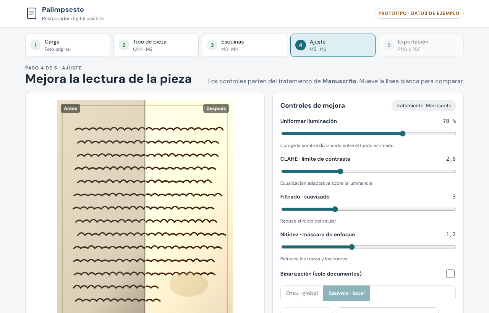 |

En la parte inferior del prototipo hay unos **controles de estados** que simulan las excepciones del flujo, cada una con el componente que la produce: archivo inválido y foto borrosa (entrada), análisis lento (ejecución), borde no detectado y esquinas cruzadas (resultado), y confianza baja y error al exportar (excepción).

| Esquinas cruzadas (M4) | Confianza baja de la CNN |
|---|---|
| 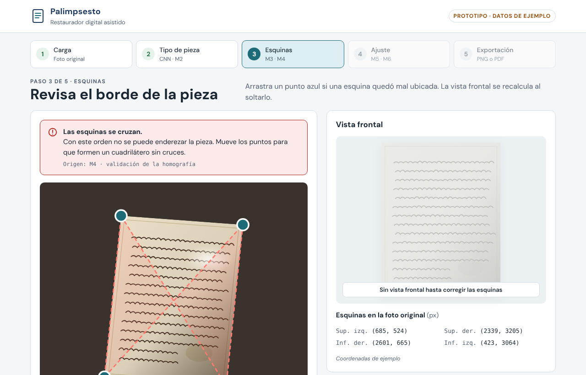 |  |

**Del prototipo a la aplicación.** La aplicación real conserva el mismo flujo y las mismas excepciones; cambian la identidad visual (verde y papel, con el logo del proyecto) y algunos detalles que surgieron al implementar: la confirmación explícita de que la foto es una pieza admitida, el control de alcance, la U-Net para proponer el borde y la exportación en ZIP con el original intacto.

### Aplicación implementada

| Paso | Qué hace el usuario | Qué responde el sistema |
|---|---|---|
| 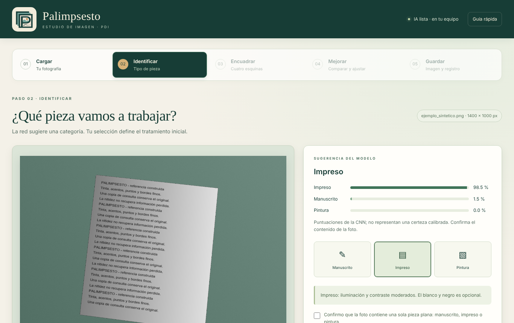 **2 · Identificar** | Confirma que la foto es una pieza admitida y confirma o cambia el tipo | Puntuaciones por clase, preajuste y alerta de alcance |
|  **3 · Encuadrar** | Arrastra las 4 esquinas, vuelve a detectar, marca a mano o gira 90° | Cuadrilátero sobre la foto y método usado (U-Net, contornos, manual) |
| 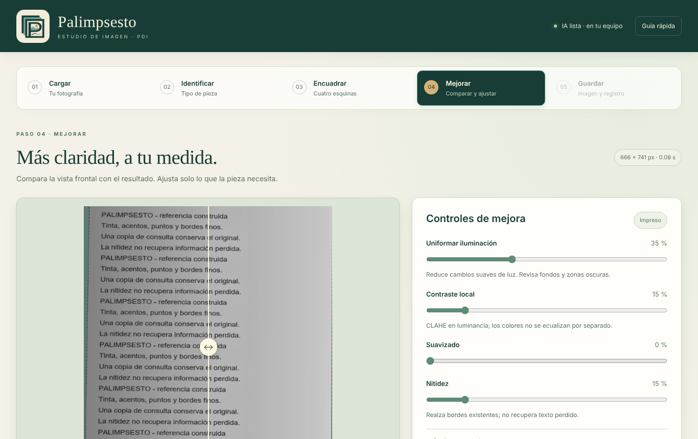 **4 · Mejorar** | Mueve deslizadores, deshace, pone en cero o amplía el detalle | Vista previa, comparación antes/después y métricas |
|  **5 · Guardar** | Descarga ZIP, PNG, PDF o JSON | Resumen de las decisiones; el original va intacto |
| 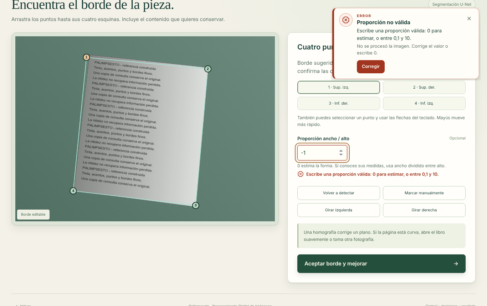 **Avisos** | Corrige o reintenta desde el propio aviso | Error, advertencia, información o éxito, siempre visibles |

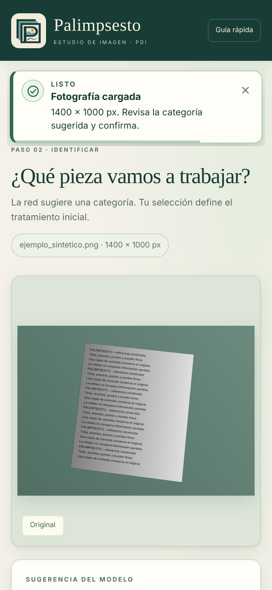

**Instrucciones de uso**

1. Abre la aplicación (ver [instalación](#9-instalación-y-ejecución)) y pulsa **Seleccionar JPG o PNG**, arrastra una foto o usa el **ejemplo sintético**.
2. Revisa la categoría sugerida, marca la casilla de confirmación y pulsa **Confirmar y revisar borde**.
3. Comprueba que los cuatro puntos caen en las esquinas de la pieza. Si no, arrástralos o pulsa **Volver a detectar** o **Marcar manualmente**. Si conoces las medidas, escribe la proporción ancho/alto; si no, deja 0.
4. Ajusta las mejoras mirando la comparación. Usa **Ver detalle** para revisar trazos finos. Si algo empeora, **Deshacer** o **Sin mejoras**.
5. Pulsa **Revisado, continuar** y descarga el ZIP completo o el formato que necesites.

**Comportamientos clave:** la interfaz funciona en escritorio y celular (de 320 a 1440 px); los errores permanecen hasta resolverse y ofrecen la acción que los corrige; descartar una foto con trabajo hecho pide confirmación; respeta la preferencia de *movimiento reducido* y se puede usar con teclado.

---

## 7. Resultados

### Clasificación del tipo de pieza

| Modelo | Evaluación | Aciertos | Macro-F1 | Alcance de la evidencia |
|---|---|---:|---:|---|
| ANN de 50 descriptores | prueba de 72 | 47/72 | 0,646 | Línea base |
| CNN del curso, variante L2 (elegida por validación) | prueba de 72 | 52/72 | 0,705 | Generalización insuficiente |
| Transferencia v0.2.0 | fuera de fold, 408 | 389/408 | 0,953 | 5 folds por 41 bloques |
| Transferencia v0.2.0 | diagnóstico secundario, 72 | 67/72 | 0,930 | Test ya abierto |
| **Transferencia v0.3.0 (desplegada)** | **fuera de fold, 408** | **391/408** | **0,958** | 5 folds por 41 bloques |
| **Transferencia v0.3.0 (desplegada)** | diagnóstico secundario, 72 | 70/72 | 0,972 | Test ya abierto; **no** es prueba ciega |


**Análisis.** La CNN entrenada desde cero con unas 340 fotos no logra separar bien impresos de manuscritos y pinturas (10 de 24 impresos acertados): con tan pocos datos memoriza el fondo y la luz. La regularización (L2, Dropout, aumentos) mejora la validación, pero no basta. La transferencia aprovecha rasgos aprendidos en ImageNet y solo entrena la última capa, lo que reduce mucho el riesgo de sobreajuste. El error que se repite es **manuscrito sugerido como impreso** en documentos con letra muy regular. Por eso la interfaz siempre pide confirmar la clase.

### Experimento de rotación (v0.2.0 → v0.3.0)

**Hipótesis.** La v0.2.0 caía de 0,93 a 0,80 de macro-F1 cuando la foto llegaba girada 90°. Entrenar la cabeza también con giros rectos debería corregirlo sin empeorar las fotos derechas.

**Regla de adopción, fijada antes de ejecutar** (`results/rotation/protocol.json`): en validación cruzada por bloques, macro-F1 en fotos derechas ≥ base − 0,01; recall ≥ 0,80 en cada clase; y macro-F1 medio en fotos giradas ≥ base + 0,05.

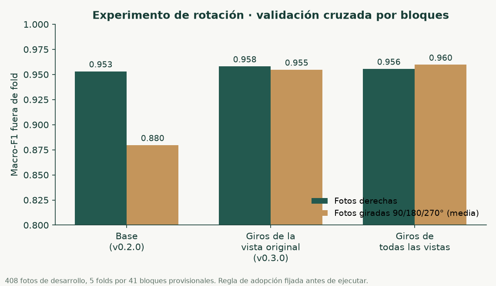

| Variante | C | Macro-F1 OOF derechas | Macro-F1 OOF giradas (media 90/180/270°) | ¿Cumple la regla? |
|---|---:|---:|---:|---|
| Base (v0.2.0) | 0,01 | 0,953 | 0,880 | — |
| **Giros de la vista original (v0.3.0)** | 0,1 | **0,958** | **0,955** | ✅ elegida |
| Giros de todas las vistas | 0,01 | 0,956 | 0,960 | ✅ |

La variante base reproduce exactamente la cifra publicada (0,9531), lo que confirma que el experimento usa el mismo encoder y los mismos folds. El modelo anterior se conserva en `models/classifier_v0.2.0.pt`. Script: `scripts/experiment_rotation.py`.

### Robustez a perturbaciones

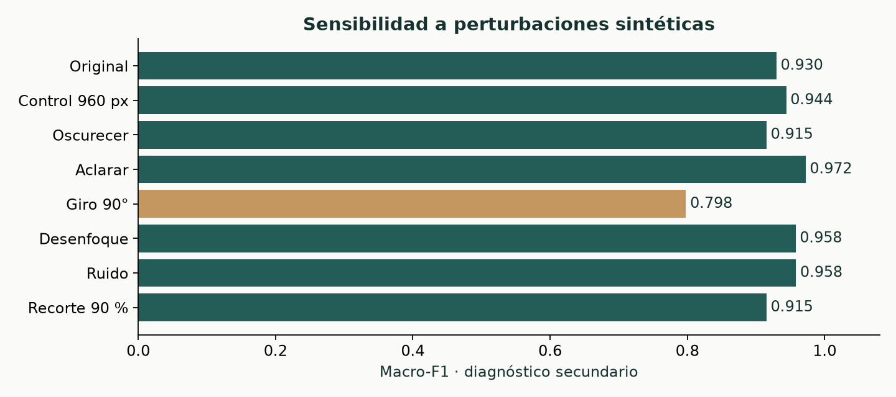

Con giro de 90°, la v0.3.0 pasa de 0,798 a 0,958. Al aclarar un 25 %, en cambio, baja de 0,972 a 0,958: un error más. Son perturbaciones sintéticas sobre fotos ya vistas, no fotos nuevas. La clasificación tarda una mediana de 56 ms en CPU.

### Detección del borde

| Método (fotos de documentos con máscara de referencia) | Fotos | Detecta | IoU media del cuadrilátero | IoU ≥ 0,95 |
|---|---:|---:|---:|---:|
| Canny (50, 150) + cierre + cuadrilátero mayor | 80 | 25 | 0,28 | 16 |
| Canny con varios umbrales + puntuación de bordes | 80 | 69 | 0,64 | 32 |
| **U-Net + cuadrilátero, fotos de prueba** | 12 | 12 | **0,968** (Dice de máscara 0,993) | 11 |
| U-Net + cuadrilátero, las 80 (incluye las 56 de entrenamiento) | 80 | 80 | 0,969 | 68 |

Los métodos clásicos no se entrenan, así que se miden sobre las 80 fotos. La cifra justa de la U-Net es la de las 12 fotos de prueba, porque la fila de 80 incluye fotos que vio durante el entrenamiento. Aun así, la diferencia frente a los contornos es grande. La U-Net se entrenó con documentos, así que en pinturas o en fondos muy distintos su sugerencia puede fallar. Por eso siempre hay contornos y borde manual como alternativa, y el usuario revisa los cuatro puntos.

### Calidad de la mejora (referencia sintética alineada)

| Caso | Sin mejora: PSNR / SSIM | Preajuste de impreso: PSNR / SSIM | Mejor técnica individual |
|---|---|---|---|
| Página limpia | ∞ / 1,000 | 33,6 / 0,997 | Hacer nada es lo correcto; los ajustes en cero conservan los píxeles |
| Sombra | 10,5 / 0,883 | 11,0 / 0,908 | Iluminación: SSIM 0,914 |
| Ruido | 28,3 / 0,543 | 26,1 / 0,501 | Suavizado: SSIM 0,614 |
| Desenfoque | 19,6 / 0,835 | 19,8 / 0,843 | FFT *high-boost*: SSIM 0,853 |

No existe un ajuste universal: cada defecto pide una técnica distinta, y por eso la mejora es ajustable y reversible. En fotos reales no hay referencia limpia, así que **la interfaz no inventa SSIM ni PSNR**: los muestra como no disponibles y usa nitidez y contraste solo como descriptores.

### Control de alcance

Alertó en 9 de 10 imágenes ajenas (gato, monedas, cohete…) y en 0 de las 72 fotos de diagnóstico. **El retrato del astronauta pasó sin alerta:** no es un detector universal. Por eso la confirmación humana de que la foto es una pieza admitida es obligatoria.

### Pruebas del sistema

| Conjunto | Resultado |
|---|---|
| `python scripts/check.py`: transformaciones, original intacto, errores, sesión, concurrencia, exportación y acceso remoto | 87/87 |
| `scripts/verify_real_pipeline.py`: 9 recorridos completos con los modelos reales (3 por clase) | 9/9 exportan PNG/PDF/JSON/ZIP con el original intacto |
| `npm run test:ui`: navegador en 320–1440 px, avisos, fallos de red, reintentos, diálogos, celular con la página desplazada, movimiento reducido | 22/22 |
| Matriz de entradas inválidas y recuperación | `docs/VALIDACION_Y_FALLOS.md` |

Las pruebas automáticas verifican los contratos del software. La evaluación experimental del modelo se describe por separado, con sus protocolos y limitaciones.

---

## 8. Conclusiones

**Principales resultados**

- Se construyó un sistema funcional de extremo a extremo (cargar → identificar → encuadrar → mejorar → exportar) que integra clasificación, segmentación y PDI clásico, corre en CPU sin conexión y conserva el original byte a byte.
- En el diagnóstico secundario de las mismas 72 fotos, el clasificador operativo acertó 70/72 y la CNN del curso 52/72. La validación cruzada del clasificador operativo obtuvo macro-F1 0,958; corresponde a otro protocolo y no se compara directamente con el F1 del diagnóstico de la CNN. Los resultados favorecen la transferencia en este conjunto, con las limitaciones de separación descritas.
- Un experimento con hipótesis y regla fijadas de antemano corrigió la debilidad ante fotos giradas (0,880 → 0,955 de macro-F1 en validación cruzada) sin empeorar las fotos derechas.
- La U-Net hizo confiable la detección del borde en documentos (IoU 0,968 en fotos de prueba, frente a 0,64 de los contornos clásicos).
- La interfaz pone a la persona en el centro: confirma la clase, corrige el borde, ve el efecto de cada ajuste y recibe avisos claros con la forma de recuperarse.

**Limitaciones**

- Las identidades físicas de las piezas no están certificadas y el diagnóstico de 72 fotos ya se había usado, así que **las métricas son provisionales y no prueban generalización a piezas nuevas**.
- Manuscritos de letra muy regular todavía se confunden con impresos; la U-Net es menos fiable fuera de los documentos.
- No hay referencia real para medir la fidelidad de la mejora; la homografía no corrige páginas curvas.

**Oportunidades de mejora**

- Certificar las piezas y capturar 6–9 piezas nuevas para una evaluación realmente independiente.
- Ampliar la U-Net con máscaras de manuscritos y pinturas.
- Ajustar el modelo completo (*fine-tuning*) una vez exista una partición certificada.
- Incorporar dewarping para páginas curvas y OCR como herramienta externa de evaluación.

---

## 9. Instalación y ejecución

Entorno comprobado: Python 3.12, PyTorch 2.15 CPU, en Windows (equipo de desarrollo) y Linux (revisión). No requiere GPU ni conexión a Internet para la inferencia.

```powershell
py -3.12 -m venv .venv
.\.venv\Scripts\python.exe -m pip install --upgrade pip
.\.venv\Scripts\python.exe -m pip install torch==2.15.0 torchvision==0.29.2 --index-url https://download.pytorch.org/whl/cpu
.\.venv\Scripts\python.exe -m pip install -r requirements.txt
```

Descarga `modelos_palimpsesto_v0.3.0.zip` de la [release pública v0.3.0](https://github.com/juanffff-hub/palimpsesto-pdi/releases/tag/v0.3.0) y extráelo en la raíz del proyecto. Deben existir `models/classifier.pt`, `models/unet_resnet18_imagenet.pth` y `models/scope_reference.npz`; sus hashes están en `models/checksums.json`. El ZIP es idéntico al publicado por el equipo (SHA-256 `9880804e55312b0cc0556a52c2ff94f03a7ef4ed08ceb820a680e4221006e577`). El dataset se necesita para reproducir los experimentos; para abrir la aplicación bastan el código, el entorno y los pesos.

```powershell
.\.venv\Scripts\python.exe run.py
```

Abre **http://127.0.0.1:8765**. También puedes usar `Instalar_Palimpsesto.cmd` y `Iniciar_Palimpsesto.cmd`. Ctrl+C detiene el servidor. En Linux/macOS usa `.venv/bin/python`. El puerto se cambia con `PALIMPSESTO_PORT`. Este lanzador escucha solo en localhost. Para compartir una demo HTTPS gratuita, consulta «Demo compartida gratuita».

Si faltan los pesos, la interfaz entra en **modo manual** (categoría y borde a mano), pero ese modo no demuestra el componente de IA. Para comprobarlo, `/api/status` debe devolver `classifier`, `segmenter` y `scope_screen` en `true`.

### Reproducir entrenamiento, evaluación y figuras

`--root` apunta a `datos/` al extraer el ZIP de la sección 5. También admite la carpeta `material_original/Material Proyecto de PDI` del paquete privado original.

```powershell
.\.venv\Scripts\python.exe scripts/train_classifier.py --root "C:\ruta\datos"      # CNN del curso y ANN
.\.venv\Scripts\python.exe scripts/train_transfer.py --root "C:\ruta\datos"        # transferencia v0.2.0
.\.venv\Scripts\python.exe scripts/experiment_rotation.py --root "C:\ruta\datos"   # experimento v0.3.0 (añade --promote para desplegar)
.\.venv\Scripts\python.exe scripts/calibrate_scope.py --root "C:\ruta\datos"
.\.venv\Scripts\python.exe scripts/evaluate_model.py --root "C:\ruta\datos"
.\.venv\Scripts\python.exe scripts/evaluate_scope.py --root "C:\ruta\datos"
.\.venv\Scripts\python.exe scripts/benchmark_quality.py
.\.venv\Scripts\python.exe scripts/make_figures.py --root "C:\ruta\datos"
.\.venv\Scripts\python.exe scripts/verify_real_pipeline.py --root "C:\ruta\datos"
.\.venv\Scripts\python.exe scripts/check.py
```

**El entrenamiento sobrescribe checkpoints y resultados:** conserva una copia de la release antes de repetirlo. `experiment_rotation.py --promote` guarda siempre el modelo anterior como `classifier_v0.2.0.pt`. Después de cambiar el clasificador, ejecuta `calibrate_scope.py` y actualiza `models/checksums.json`. Las semillas fijas reducen la variación, pero no garantizan resultados idénticos bit a bit entre equipos.

**Pruebas de navegador:** con el servidor activo, `npm install` y `npm run test:ui` (Node y Chrome; `CHROME_PATH` es opcional). Las capturas del README se regeneran con `node scripts/capture_gui.cjs`.

---

## Cierre técnico y entregables

El repositorio reúne los ocho apartados documentales de la rúbrica y evidencia experimental con datos reales, métricas, ejemplos y análisis de limitaciones. Consulta la [matriz de cumplimiento](docs/CIERRE_RUBRICA.md).

La evaluación corresponde al dataset y a los protocolos documentados: no constituye una certificación de fidelidad patrimonial ni una garantía de generalización a cualquier pieza. La certificación de identidades físicas y la evaluación con piezas nuevas son ampliaciones recomendadas; no se han usado para inflar las cifras existentes.

Quedan los entregables de comunicación: **póster académico, video de máximo tres minutos y sustentación oral**, incluida la demostración del funcionamiento.

## Demo compartida gratuita

Ejecuta `Iniciar_Enlace_Publico.cmd` para obtener un enlace HTTPS sin cuenta ni tarjeta. Se publica la aplicación completa, con las dos redes y el control de alcance. El enlace aparece en la consola y en `.public_runtime/enlace.txt`. Para cerrarlo, usa `Detener_Enlace_Publico.cmd`.

El computador debe permanecer encendido y conectado. Es una demostración temporal: al reiniciar el túnel cambia la URL y no hay garantía de disponibilidad continua. Las fotos se procesan en el computador anfitrión a través de Cloudflare; las sesiones se eliminan tras 15 minutos sin actividad, con limpieza cada 30 segundos.

El gestor consulta `main` de este repositorio cada 90 segundos. Los cambios de aplicación se aplican cuando no detecta sesiones activas; la URL del túnel se conserva mientras siga abierto. Un cambio solo de documentación o de historia/autor no reinicia la aplicación. Si cambian las dependencias o faltan pesos compatibles, se conserva la versión anterior y se explica el motivo en el registro. [Operación y actualizaciones](docs/DEMO_PUBLICA.md).

## Referencias

- Canny, J. (1986). A computational approach to edge detection. *IEEE TPAMI, 8*(6), 679–698. https://doi.org/10.1109/TPAMI.1986.4767851
- Gonzalez, R. C., & Woods, R. E. (2018). *Digital image processing* (4.ª ed.). Pearson.
- Hartley, R., & Zisserman, A. (2004). *Multiple view geometry in computer vision* (2.ª ed.). Cambridge University Press.
- He, K., Zhang, X., Ren, S., & Sun, J. (2016). Deep residual learning for image recognition. *CVPR*, 770–778.
- Liang, J., Doermann, D., & Li, H. (2005). Camera-based analysis of text and documents: A survey. *IJDAR, 7*(2–3), 84–104. https://doi.org/10.1007/s10032-004-0138-z
- Otsu, N. (1979). A threshold selection method from gray-level histograms. *IEEE TSMC, 9*(1), 62–66.
- Ronneberger, O., Fischer, P., & Brox, T. (2015). U-Net: Convolutional networks for biomedical image segmentation. *MICCAI*, 234–241.
- Sauvola, J., & Pietikäinen, M. (2000). Adaptive document image binarization. *Pattern Recognition, 33*(2), 225–236.
- Srivastava, N., et al. (2014). Dropout: A simple way to prevent neural networks from overfitting. *JMLR, 15*(56), 1929–1958.
- UNESCO. (2003). *Carta sobre la preservación del patrimonio digital*.
- Wang, Z., Bovik, A. C., Sheikh, H. R., & Simoncelli, E. P. (2004). Image quality assessment: From error visibility to structural similarity. *IEEE TIP, 13*(4), 600–612.
- Zuiderveld, K. (1994). Contrast limited adaptive histogram equalization. En *Graphics gems IV* (pp. 474–485). Academic Press.
- Documentación: [OpenCV · homografía](https://docs.opencv.org/4.x/d9/dab/tutorial_homography.html), [PyTorch · transferencia](https://docs.pytorch.org/tutorials/beginner/transfer_learning_tutorial.html), [scikit-image · métricas](https://scikit-image.org/docs/stable/api/skimage.metrics.html), [scikit-learn · StratifiedGroupKFold](https://scikit-learn.org/stable/modules/generated/sklearn.model_selection.StratifiedGroupKFold.html).

**Derechos.** No se presupone una licencia pública para las fotografías, las obras ni el material docente. El código y los modelos se entregan para este proyecto académico; revisa las autorizaciones antes de redistribuir. Las bibliotecas y el preentrenamiento conservan sus propias licencias.

**Estado del proyecto.** `docs/ESTADO_PROYECTO.md` resume la versión, los comandos y las limitaciones para el mantenimiento del equipo.
