# Palimpsesto

**Una nueva mirada. La misma pieza.** Asistente local de procesamiento digital de imágenes que convierte la foto de celular de un manuscrito, un documento impreso o una pintura plana en una copia frontal y legible, sin perder el control humano sobre cada paso.

Proyecto final de **Procesamiento Digital de Imágenes** · Universidad Autónoma de Occidente · Profesor Nicolás Llanos Neuta
Equipo: **David Neira Conde · Juan Sebastián Gómez Muñoz · Juan Felipe Fajardo Valencia**
Macroproyecto: *Análisis de la Expresión Humana en el Arte y la Cultura* (línea de patrimonio cultural, obras de arte y museos).


| Sección de la rúbrica | Dónde está |
|---|---|
| Descripción del proyecto | [1. Descripción](#1-descripción-del-proyecto) |
| Arquitectura del sistema | [2. Arquitectura](#2-arquitectura-del-sistema) |
| Metodología | [3. Metodología](#3-metodología) |
| Implementación | [4. Implementación](#4-implementación) |
| Datos | [5. Datos](#5-datos) |
| Interfaz gráfica de usuario | [6. Interfaz](#6-interfaz-gráfica-de-usuario) |
| Resultados | [7. Resultados](#7-resultados) |
| Conclusiones | [8. Conclusiones](#8-conclusiones) |
| Instalación y ejecución | [9. Instalación](#9-instalación-y-ejecución) |

---

## 1. Descripción del proyecto

### Problemática

Gran parte del patrimonio documental y artístico (manuscritos, cartas, diplomas, pinturas) circula únicamente en fotografías que visitantes, estudiantes e investigadores toman con su celular en archivos, bibliotecas y museos. Esas capturas rara vez cumplen las condiciones de una digitalización profesional: la pieza aparece torcida, con distorsión de perspectiva, iluminación desigual, sombras, reflejos o desenfoque, lo que dificulta leerla, archivarla y analizarla después (Liang et al., 2005).

**Escenario de uso.** Una investigadora en historia consulta manuscritos en la sala de un archivo. No tiene escáner: solo su celular, sin trípode ni luz controlada, y un horario de consulta limitado. Con frecuencia descubre días después, en su computador, que parte del texto no se lee; corregirlo implica volver al archivo, pedir la pieza otra vez y manipular un original que la conservación busca proteger.

**Pregunta guía:** ¿cómo corregir la perspectiva y mejorar la legibilidad de una fotografía imperfecta de una pieza cultural, adaptando el tratamiento al tipo de pieza y permitiendo que el usuario lo supervise, mediante procesamiento digital de imágenes y redes neuronales convolucionales?

### Justificación

- La UNESCO (2003) reconoce como patrimonio digital los recursos que se convierten a formato digital a partir de material analógico y llama a conservarlos. Una captura ilegible no sirve para citar la fuente ni para incorporarla a un archivo digital.
- **Un mismo tratamiento no sirve para todo:** binarizar un manuscrito puede borrar trazos débiles, y "mejorar" el color de una pintura altera la obra. Por eso una red identifica el tipo de pieza y ese tipo define el tratamiento inicial.
- **La persona que conoce la pieza debe decidir.** Una imagen "bonita" no garantiza fidelidad documental; el sistema propone y el usuario confirma, corrige o rechaza en cada etapa.
- **Valor práctico:** permite descubrir *antes de salir de la sala* que la foto no sirve y repetirla mientras la pieza sigue sobre la mesa. El **semáforo de la captura** lo dice en cuanto se carga la foto.

### Objetivos

**General.** Desarrollar un sistema interactivo de procesamiento digital de imágenes y aprendizaje profundo que, a partir de una fotografía imperfecta de una pieza de valor cultural, identifique su tipo, corrija su perspectiva y mejore su iluminación y nitidez, permitiendo al usuario supervisar y ajustar cada etapa, para producir una imagen legible y apta para el archivo digital.

**Objetivos específicos del prototipo y estado**

| Objetivo específico | Estado en esta versión |
|---|---|
| 1. Construir un conjunto de imágenes reales de celular y versiones con distorsión sintética, e implementar la corrección geométrica (esquinas + homografía). | ✅ 480 fotos reales etiquetadas; perturbaciones y referencias sintéticas; U-Net de 3 clases (240 fotos con máscara: impresos, manuscritos y pinturas) + contornos + borde manual; homografía sobre RGB original. |
| 2. Diseñar, entrenar y validar una CNN que clasifique la pieza (manuscrito, impreso, pintura) controlando el sobreajuste con *data augmentation*, Dropout y L2; implementar la mejora con preajuste por clase y conservando el color en pinturas. | ✅ CNN del curso con 5 variantes (base, Dropout, L2, aumentos, combinada) + ANN de descriptores; clasificador operativo por transferencia (ResNet18); preajustes por clase; pinturas sin binarización. |
| 3. Integrar los módulos en un prototipo web interactivo y evaluar el sistema mediante datos reales, métricas cuantitativas y pruebas de funcionamiento. | ✅ Prototipo de cinco pasos; clasificación, segmentación, mejora y exportación evaluadas. |

### Solución propuesta

Palimpsesto actúa como un **restaurador digital asistido** en cinco pasos:

1. **Cargar** la foto (JPG/PNG). Se valida el archivo, se corrige la orientación EXIF y se comprueba si el contenido parece una pieza admitida. Un **semáforo de la captura** revisa nitidez, luz, reflejos, encuadre y tamaño de la pieza y dice si conviene repetir la foto.
2. **Identificar**: una CNN sugiere el tipo de pieza y el usuario lo confirma o lo cambia.
3. **Encuadrar**: una U-Net, entrenada con impresos, manuscritos y pinturas, propone las cuatro esquinas e indica si el borde es **seguro o dudoso**; el usuario puede ver la máscara que predijo la red, y revisa, arrastra o marca a mano las esquinas.
4. **Mejorar**: homografía a vista frontal y mejora clásica ajustable (iluminación, CLAHE, suavizado, nitidez, binarización solo en documentos), con comparación antes/después y detalle a resolución real. Un **histograma de luminancia** muestra el efecto del ajuste y avisa si quema u oscurece detalle, señalando dónde.
5. **Guardar**: PNG, PDF, registro JSON de todas las decisiones y un ZIP que incluye el **original byte a byte**.

> **La CNN no restaura la imagen: decide cómo debe restaurarse.** La geometría y la calidad se corrigen con técnicas clásicas de PDI vistas en el curso, y la persona supervisa cada etapa.

**Alcance.** Imágenes estáticas de una pieza plana o casi plana por foto. No transcribe texto (OCR), no reconstruye partes perdidas, no aplana páginas curvas y no certifica colorimetría patrimonial.

---

## 2. Arquitectura del sistema

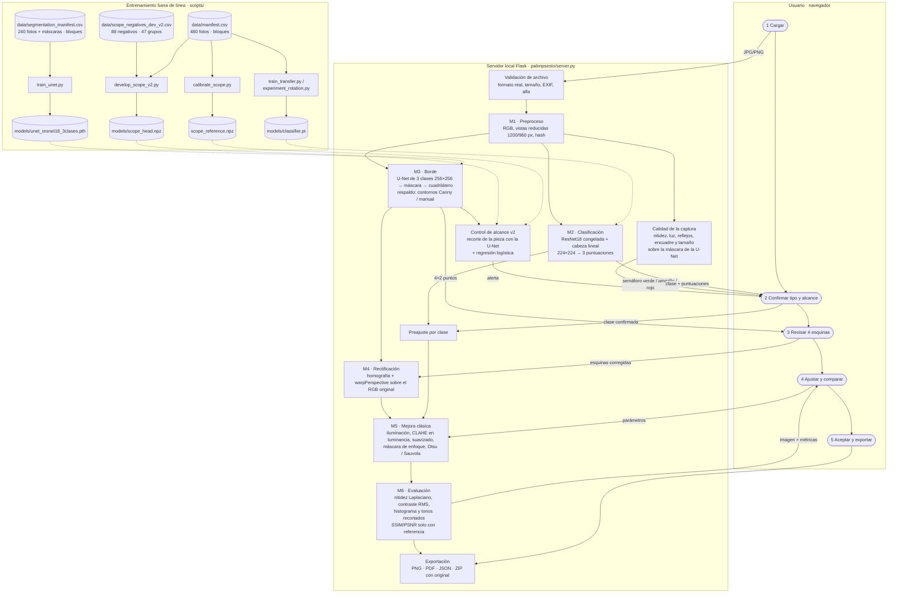

| Módulo | Entrada → salida | Técnica | Archivo |
|---|---|---|---|
| Validación | bytes → RGB uint8 | decodificación real, límites de tamaño/píxeles, EXIF, alfa sobre blanco | `palimpsesto/imaging.py` |
| M1 Preproceso | RGB → vista previa (1200 px), vista de detección (960 px), hash | redimensión INTER_AREA, SHA-256 | `imaging.py` |
| Alcance (v2) | RGB + máscara de la U-Net → probabilidad de pieza válida → alerta sí/no | recorte de la pieza, rasgos del encoder ResNet18 congelado y regresión logística binaria (umbral 0,306); sin la cabeza v2, similitud top-3 de la v0.4.0 | `palimpsesto/models.py` |
| Calidad de la captura | RGB + máscara de la U-Net → veredicto y 5 chequeos | segunda derivada por dirección y por bloques, percentil 95 de luminancia, manchas saturadas compactas (componentes conexas), contacto de la máscara con el borde | `palimpsesto/capture.py` |
| M2 Clasificación | RGB 224×224 → 3 puntuaciones | ResNet18 ImageNet congelada + cabeza lineal | `models.py` |
| M3 Borde | RGB 256×256 → máscara → 4 puntos + confianza (segura / dudosa) | U-Net de 3 clases (encoder ResNet18); encaje de los 4 puntos con la máscara y ancho de la franja incierta; contornos; manual | `models.py`, `imaging.py` |
| M4 Rectificación | RGB + 4 puntos → vista frontal | homografía (`getPerspectiveTransform`, `warpPerspective`) | `imaging.py` |
| M5 Mejora | vista frontal + parámetros → resultado | en el canal L de Lab: filtro bilateral, división por fondo gaussiano, CLAHE, máscara de enfoque; Otsu/Sauvola en documentos | `imaging.py` |
| M6 Evaluación | antes/después → métricas | varianza del Laplaciano, contraste RMS; histograma de luminancia (64 niveles) y píxeles que el ajuste llevó a negro o blanco puros; SSIM/PSNR con referencia | `imaging.py` |
| Exportación | resultado + registro → archivos | PNG, PDF (ReportLab), JSON, ZIP con original | `palimpsesto/exporting.py` |
| Interfaz | — | HTML/CSS/JS sin compilación, canvas de esquinas, avisos | `templates/`, `static/` |

---

## 3. Metodología

### Etapas del desarrollo

| Fase | Qué se hizo | Evidencia |
|---|---|---|
| 1. Planeación | Problemática, escenario, alcance y arquitectura (documento de definición). | Propuesta del equipo |
| 2. Datos | 480 fotos reales con celular (160 por clase), manifiesto con hash y **bloques por pieza** para evitar fuga entre entrenamiento y prueba. | `data/manifest.csv`, `docs/DATA_CARD.md` |
| 3. Geometría | Comparación de detección clásica (Canny + contornos) frente a U-Net; homografía sobre el original. Después, ampliación de la U-Net a manuscritos y pinturas con 160 máscaras nuevas (v0.4.0). | `results/research/`, `results/segmentation/` |
| 4. Mejora | Comparación de técnicas en referencias sintéticas alineadas (iluminación, CLAHE, suavizado, nitidez, FFT). | `results/quality/` |
| 5. Clasificación | CNN del curso (5 variantes) y ANN de descriptores; luego transferencia ResNet18 con validación cruzada por bloques; experimento de rotación. | `results/classification/`, `results/transfer/`, `results/rotation/` |
| 6. Interfaz | Aplicación web de cinco pasos con supervisión, avisos y recuperación de errores. | `templates/`, `static/` |
| 7. Evaluación | Pruebas automáticas (Python, modelos reales, navegador) y diagnósticos de robustez y alcance. | `tests/`, `results/` |

### Técnicas de PDI y visión por computador

- **Espacio de color y geometría:** conversión RGB, orientación EXIF, homografía de cuatro puntos y remuestreo (Hartley & Zisserman, 2004).
- **Detección de bordes y contornos:** Canny (1986), morfología y aproximación poligonal como alternativa a la U-Net.
- **Segmentación:** U-Net con encoder ResNet18, con la receta del tercer parcial (Soft Dice, Adam, volteo y giro). En el parcial se entrenó solo con documentos impresos (80 fotos); en la v0.4.0 se reentrenó con **240 fotos de las tres clases** (80 impresos, 80 manuscritos y 80 pinturas anotados con polígonos en makesense.ai). De su máscara se extrae el cuadrilátero.
- **Mejora (en el canal L de Lab, para no alterar el tono):** filtro bilateral contra el ruido; estimación de iluminación con filtro gaussiano grande y división; CLAHE (Zuiderveld, 1994); máscara de enfoque; binarización global de Otsu (1979) y local de Sauvola (2000) solo en documentos.
- **Frecuencia:** filtro *high-boost* con FFT, evaluado en `notebooks/Palimpsesto_experimentos.ipynb` y `results/quality/`, pero no desplegado porque no superó a los filtros espaciales.
- **Confianza del borde:** IoU entre el cuadrilátero y la máscara de la propia U-Net, y ancho medio de la franja de probabilidad incierta (0,1 < p < 0,9) del contorno; la máscara se muestra superpuesta para que la persona vea en qué se basó la red.
- **Calidad de la captura:** nitidez como varianza de la segunda derivada en *x* y en *y* por bloques de la pieza (el temblor borra una sola dirección), exposición por histograma de luminancia (percentil 95), reflejos como componentes conexas saturadas y compactas, y encuadre a partir de la máscara de la U-Net.
- **Histograma:** histograma de luminancia antes y después del ajuste, y recorte de tonos medido píxel a píxel (lo que el ajuste llevó a ≤ 2 o ≥ 253 y antes no lo estaba); se muestra dónde ocurre.
- **Métricas:** SSIM (Wang et al., 2004) y PSNR solo cuando hay referencia alineada; nitidez (varianza del Laplaciano) y contraste RMS como descriptores, no como notas de fidelidad.

### Modelos

| Modelo | Arquitectura | Papel en el sistema |
|---|---|---|
| **CNN del curso** | 4 convoluciones (16/32/64/128) + pooling + FC 64 → 3; 5 variantes: base, Dropout, L2, aumentos, combinada | Línea base académica; se conserva con sus resultados. |
| **ANN de descriptores** | 50 descriptores (histograma RGB, bordes, nitidez) → 32 → 3 | Línea base sin convoluciones. |
| **Clasificador operativo v0.3.0** | ResNet18 ImageNet congelada + cabeza lineal (regresión logística L2) entrenada con vistas de brillo, giros de ±8° y **giros de 90°/180°/270°** | Sugiere el tipo de pieza en la interfaz. |
| **U-Net de 3 clases (v0.4.0)** | Encoder ResNet18 ImageNet, entrada 256×256, 1 canal; entrenada con impresos, manuscritos y pinturas | Propone el borde de la pieza en las tres clases. |
| U-Net del Parcial 3 | La misma arquitectura, entrenada solo con impresos | Línea base de la comparación; se conserva en la release. |
| **Control de alcance v2** | Recorte de la pieza con la U-Net → 512 rasgos del encoder congelado → regresión logística binaria (C = 10, clases ponderadas) | Avisa si la foto no parece una pieza admitida; la persona siempre confirma. Sustituye al banco de similitud de la v0.4.0, que se conserva como respaldo. |

**Protocolo de evaluación.** Las fotos de una misma pieza física son muy parecidas, así que dividir al azar infla los resultados. Por eso las particiones se hacen por **bloques** (41 en desarrollo y 9 en el diagnóstico) con `StratifiedGroupKFold` (5 folds, semilla 2026). Los hiperparámetros se eligen solo con validación cruzada en desarrollo. Las 72 fotos de diagnóstico ya se habían usado con la CNN del curso, así que **se reportan como diagnóstico secundario y no como prueba ciega**.

### Cambios respecto a la propuesta inicial

| Propuesta | Implementación | Motivo |
|---|---|---|
| Interfaz en Gradio | Flask + HTML/JS propios | Canvas de esquinas con arrastre y teclado, avisos accesibles y control fino de la sesión y del original. |
| CNN de 128×128 como clasificador final | La CNN del curso se conserva como línea base; el clasificador operativo es transferencia ResNet18 | La CNN propia alcanzó 52/72 (macro-F1 0,705), por debajo de la puerta de despliegue. |
| Esquinas con Canny + contornos | U-Net + contornos + manual | Con contornos, la IoU media fue 0,64; con la U-Net, 0,968 en fotos de prueba (ver Resultados). |
| U-Net del parcial, solo para documentos; contornos en pinturas | U-Net de 3 clases para todas las piezas | La U-Net de impresos fallaba en pinturas. Con 160 máscaras nuevas, la IoU media del borde en prueba pasó de 0,811 a 0,937 (ver Resultados). |
| Partición aleatoria 80/10/10 | Partición por bloques de pieza | Evita evaluar con fotos de la misma pieza que se usó para entrenar. |

---

## 4. Implementación

```
palimpsesto/        Núcleo del sistema
  server.py         API Flask local: carga, detección, rotación, proceso, exportación; sesiones aisladas
  imaging.py        Validación, EXIF, homografía, mejora clásica, métricas
  models.py         Carga estricta de pesos (weights_only=True), clasificación, U-Net y control de alcance v2 (recorte de la pieza)
  exporting.py      PNG, PDF, JSON y ZIP con el original y sus hashes
  capture.py        Semáforo de la captura: nitidez, luz, reflejos, encuadre y tamaño de la pieza
  weights.py        Al iniciar, comprueba los pesos por SHA-256 y descarga los de la release vigente
templates/index.html  Interfaz de cinco pasos
static/app.js       Flujo de la interfaz (carga → identificar → encuadrar → mejorar → guardar)
static/feedback.js  Sistema de avisos: éxito, información, advertencia, error, mensajes de campo, diálogos
static/*.css        Identidad visual (papel + verde bosque), avisos y animaciones
scripts/            Entrenamiento, calibración, evaluación, figuras y verificación
tests/              113 pruebas Python y 25 de navegador
notebooks/          Recorrido académico con FFT y evaluación
data/manifest.csv   480 fotos, clase, bloque, partición y hash
data/segmentation_manifest.csv  240 fotos con máscara, clase, bloque, partición y hash (U-Net)
results/            Fuente numérica de todas las cifras del README
docs/               Fichas de modelo y datos, validación, guía de sustentación
```

| Funcionalidad | Cómo se implementa |
|---|---|
| El original nunca se modifica | Se guardan sus bytes y su SHA-256; las transformaciones trabajan sobre copias y el ZIP incluye el archivo exacto. |
| Resultados que no se mezclan | Cada imagen tiene una clave y cada procesamiento una revisión; un enlace viejo o una pestaña con otra foto se rechazan. |
| Clasificación con supervisión | Si la puntuación es baja, si falta el modelo o si el contenido parece ajeno, la interfaz no impone la clase. |
| Ver lo que vio la red | En el paso 3, la máscara de la U-Net se superpone a la foto (verde: pieza; naranja: zona dudosa) y una etiqueta dice si el borde es seguro o dudoso, con el motivo. Si es dudoso, la máscara aparece sola y se ofrece marcar a mano. |
| Avisar a tiempo | Al cargar la foto, un semáforo (verde, amarillo o rojo) explica qué falla y ofrece cargar otra; se recalcula si cambias el tipo de pieza y queda en el registro JSON. |
| Esquinas revisables | Canvas con arrastre, selección de punto y flechas del teclado; la geometría inválida (cruzada, repetida, fuera de la foto) se rechaza. |
| Ajustes reversibles | Deshacer, mejoras en cero y comparación antes/después con la misma geometría. |
| Ver el efecto en los tonos | Histograma antes/después en el paso 4. Si el ajuste quema u oscurece más del 1 % de la imagen, avisa y puede pintar en magenta (blancos) o cian (negros) los píxeles recortados sobre el «después». |
| Avisos y recuperación | `feedback.js`: avisos dentro de la ventana con icono, título y acción (Reintentar, Ir al campo, Cargar otra foto). |

---

## 5. Datos

| Conjunto | Contenido | Uso |
|---|---|---|
| **Fotos de clasificación** | 480 fotografías propias tomadas con celular, 160 por clase (impreso, manuscrito, pintura); 50 bloques provisionales de pieza | Entrenamiento y evaluación del clasificador y calibración del alcance |
| **Segmentación** | 240 fotos con máscara, 80 por clase: 80 impresos del tercer parcial (18 documentos) + 80 manuscritos (10 piezas) y 80 pinturas (13 bloques) anotados con polígonos en makesense.ai; partición por pieza (160 / 40 / 40) | Entrenar y evaluar la U-Net |
| **Referencias sintéticas** | Página construida con sombra, ruido y desenfoque controlados | Comparar técnicas de mejora con SSIM/PSNR |
| **Negativos de alcance exploratorios** | 10 imágenes públicas de scikit-image (gato, astronauta, monedas…) | Comprobación inicial de la alerta de contenido ajeno |
| **Negativos de alcance v2 · desarrollo** | 88 fotografías propias nuevas fuera de alcance (21 escenas, 52 objetos 3D, 15 negativos difíciles), agrupadas en 47 identidades (`data/scope_negatives_dev_v2.csv`) | Ajustar y comparar el control de alcance v2 |
| **Negativos de alcance v2 · prueba ciega** | 18 fotografías propias nuevas (6 escenas, 6 objetos 3D, 6 negativos difíciles) | Prueba ciega única del control v2; no se abrieron durante el desarrollo |
| **Negativos externos v1** | 30 fotografías propias nuevas, una por objeto o escena: 10 escenas, 10 objetos tridimensionales y 10 negativos difíciles | Prueba externa congelada del filtro de alcance; no se usan para entrenar ni ajustar el umbral |

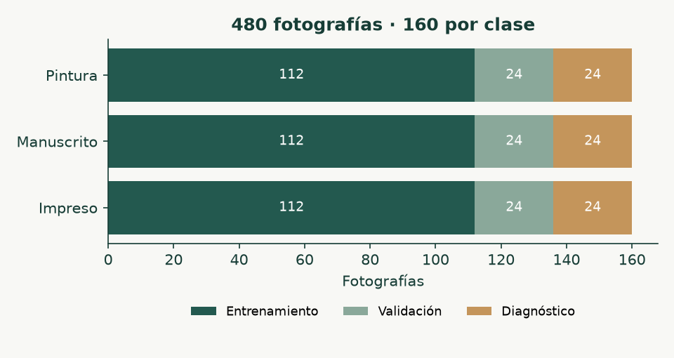


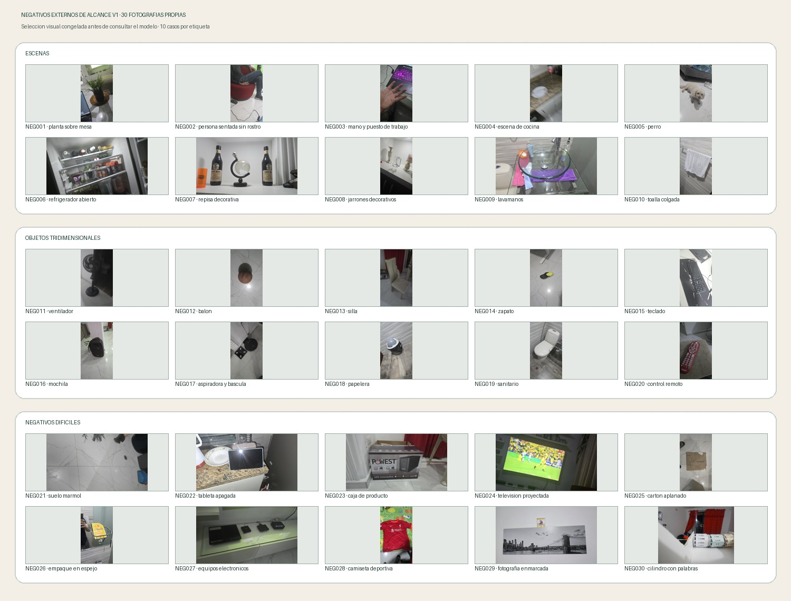

Las fotos se tomaron en contextos reales: distintos fondos, luz natural y artificial, reflejos y ángulos. Las miniaturas de documentos aparecen difuminadas porque algunos contienen nombres de personas.

**Acceso a los datos (sin cuenta ni invitación)**

- **Google Drive · [Dataset de Palimpsesto](https://drive.google.com/drive/folders/1IIC5X-oEXs4mcuuWMMLGhzr5HQmRVveq?usp=sharing).** Contiene `DatasetPalimpsesto.zip` (1,2 GB) con **todas las fotos del proyecto separadas por rol**:
  - `01_clasificacion`: las 480 fotos, por partición y clase.
  - `02_segmentacion_unet`: 240 fotos, sus máscaras y las anotaciones de makesense.ai.
  - `03_control_alcance`: los negativos exploratorios, v1, v2 de desarrollo y v2 de prueba ciega.

  Incluye un `LEEME.md` que explica cada carpeta y el SHA-256 de cada archivo.
- **Releases de GitHub**, para reproducir los experimentos con los scripts (sección 9). Los hashes de cada ZIP están en `docs/DATA_CARD.md`.

| Archivo | Contenido | Uso en los scripts |
|---|---|---|
| [dataset_palimpsesto_v1.zip](https://github.com/juanffff-hub/palimpsesto-pdi/releases/download/v0.3.0/dataset_palimpsesto_v1.zip) · 820 MB | Las 480 fotos con su estructura original, `manifest.csv` y hashes | `--root` apunta a su carpeta `datos/` |
| [segmentacion_3clases_v1.zip](https://github.com/juanffff-hub/palimpsesto-pdi/releases/download/v0.4.0/segmentacion_3clases_v1.zip) · 209 MB | 240 fotos, 240 máscaras y anotaciones COCO | `--data` / `--seg` |
| [negativos_alcance_v1.zip](https://github.com/juanffff-hub/palimpsesto-pdi/releases/download/v0.4.0/negativos_alcance_v1.zip) · 79 MB | 30 negativos de la prueba externa v1 | `evaluate_scope_external.py --data` |
| [negativos_alcance_v2_desarrollo.zip](https://github.com/juanffff-hub/palimpsesto-pdi/releases/download/v0.4.0/negativos_alcance_v2_desarrollo.zip) · 142 MB | 88 negativos de desarrollo v2 | `develop_scope_v2.py --neg` |
| [negativos_alcance_v2_prueba_ciega.zip](https://github.com/juanffff-hub/palimpsesto-pdi/releases/download/v0.4.0/negativos_alcance_v2_prueba_ciega.zip) · 57 MB | 18 negativos de la prueba ciega v2, ya ejecutada una vez | Solo consulta |

Las fotos propias de los negativos están saneadas: sin EXIF/GPS ni nombres originales.

- **Código y pesos:** este repositorio y su [release v0.4.0](https://github.com/juanffff-hub/palimpsesto-pdi/releases/tag/v0.4.0), sin cuenta ni permisos de colaborador.
- `data/manifest.csv` relaciona cada foto con su clase, bloque, partición y hash; `data/segmentation_manifest.csv` hace lo mismo con las 240 fotos de segmentación. Los 50 bloques son una agrupación automática y conservadora: la identidad física de las piezas aún no está certificada (`group_verified=false`).
- Detalle de procedencia, sesgos y licencias: `docs/DATA_CARD.md`.

---

## 6. Interfaz gráfica de usuario

### Prototipo

Antes de programar la aplicación, el flujo de cinco pasos de la Tabla 2 de la propuesta se diseñó como un **prototipo navegable** (Momento 3). Representa las pantallas, la conexión entre ellas y los estados alternativos, con datos de ejemplo y sin ejecutar ninguna función real. Se abre con doble clic en cualquier navegador: [`docs/prototipo/palimpsesto_prototipo.html`](docs/prototipo/palimpsesto_prototipo.html).

| Inicio | Tipo de pieza | Esquinas | Ajuste |
|---|---|---|---|
| 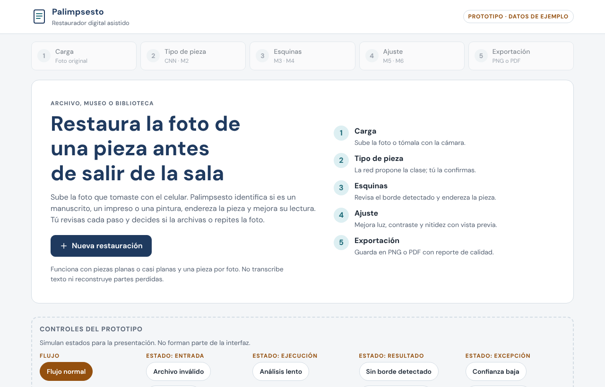 |  | 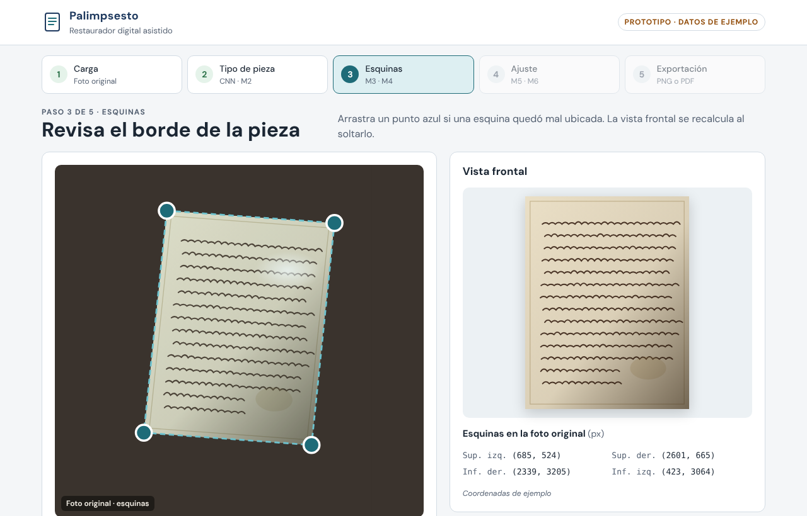 |  |

En la parte inferior del prototipo hay unos **controles de estados** que simulan las excepciones del flujo, cada una con el componente que la produce: archivo inválido y foto borrosa (entrada), análisis lento (ejecución), borde no detectado y esquinas cruzadas (resultado), y confianza baja y error al exportar (excepción).

| Esquinas cruzadas (M4) | Confianza baja de la CNN |
|---|---|
|  | 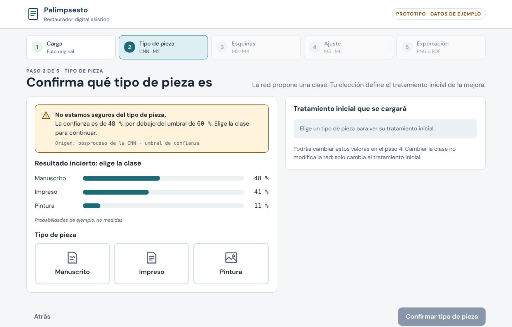 |

**Del prototipo a la aplicación.** La aplicación real conserva el mismo flujo y las mismas excepciones; cambian la identidad visual (verde y papel, con el logo del proyecto) y algunos detalles que surgieron al implementar: la confirmación explícita de que la foto es una pieza admitida, el control de alcance, la U-Net para proponer el borde y la exportación en ZIP con el original intacto.

### Aplicación implementada

| Paso | Qué hace el usuario | Qué responde el sistema |
|---|---|---|
|  **2 · Identificar** | Confirma que la foto es una pieza admitida y confirma o cambia el tipo | Puntuaciones por clase, preajuste y alerta de alcance |
| 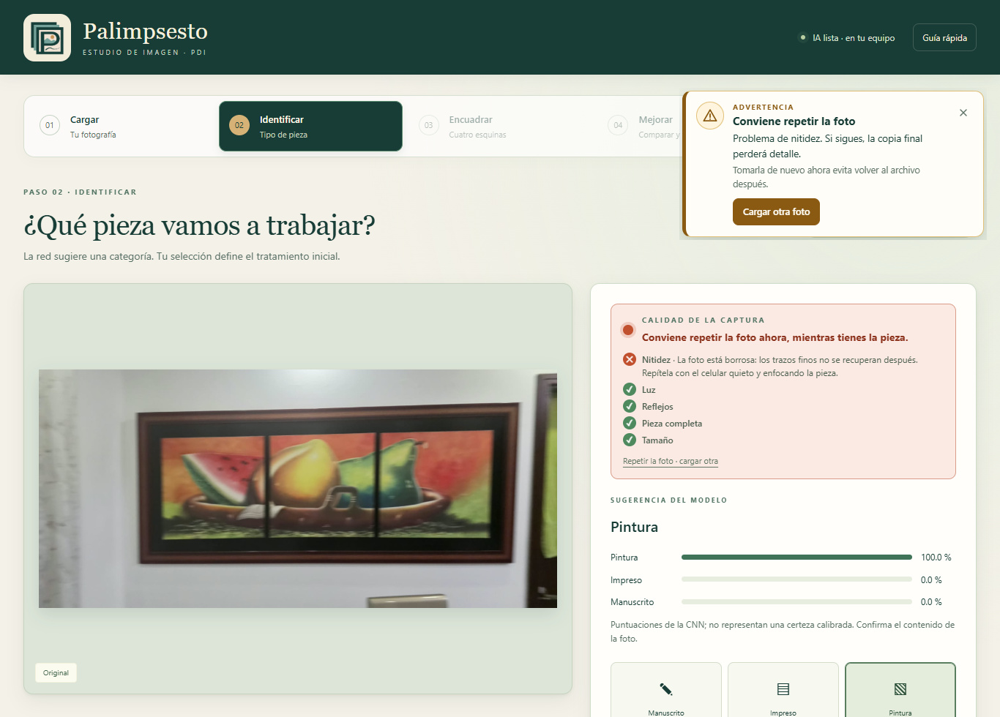 **2 · Semáforo de la captura** | Lee si la foto sirve; si está en rojo, la repite con un clic | Veredicto, cinco chequeos con el motivo concreto y botón para cargar otra foto |
| 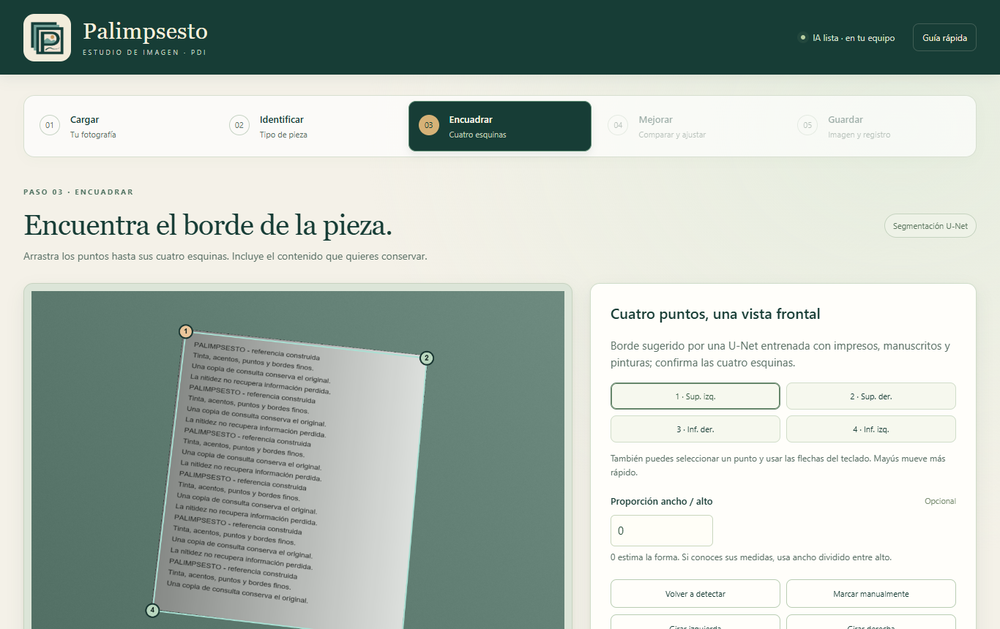 **3 · Encuadrar** | Arrastra las 4 esquinas, vuelve a detectar, marca a mano o gira 90° | Cuadrilátero sobre la foto y método usado (U-Net, contornos, manual) |
| 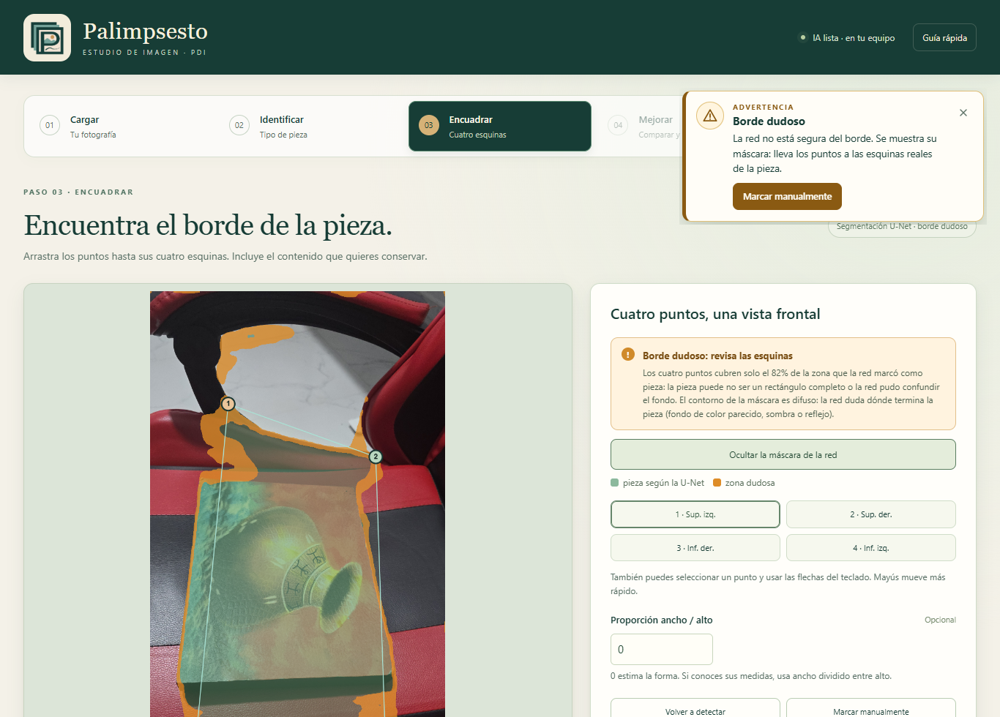 **3 · Borde dudoso** | Mira la máscara de la red y lleva los puntos a las esquinas reales | Etiqueta «borde dudoso» con el motivo, máscara superpuesta y acceso al borde manual |
|  **4 · Mejorar** | Mueve deslizadores, deshace, pone en cero o amplía el detalle | Vista previa, comparación antes/después y métricas |
| 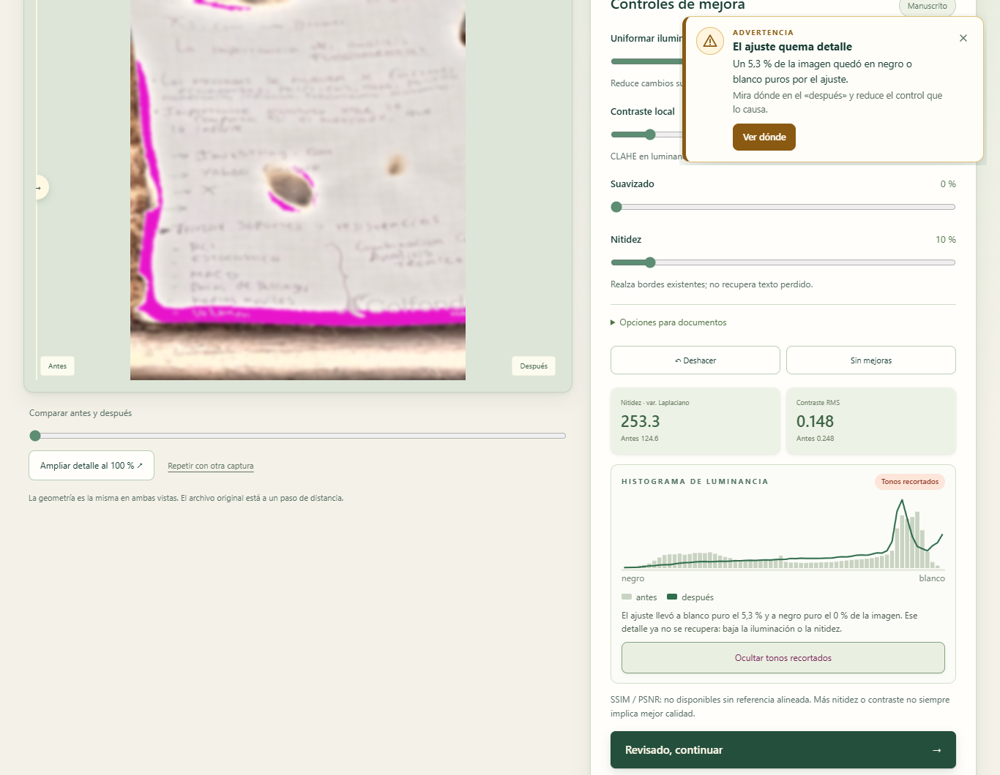 **4 · Tonos recortados** | Lee el histograma y, si hay recorte, mira dónde y baja el control que lo causa | Histograma antes/después, porcentaje recortado y zonas en magenta |
| 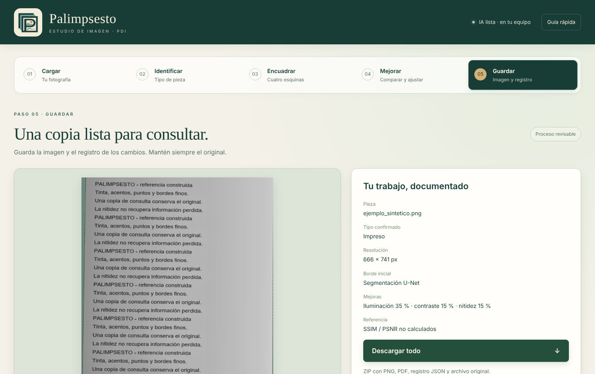 **5 · Guardar** | Descarga ZIP, PNG, PDF o JSON | Resumen de las decisiones; el original va intacto |
|  **Avisos** | Corrige o reintenta desde el propio aviso | Error, advertencia, información o éxito, siempre visibles |


**Instrucciones de uso**

1. Abre la aplicación (ver [instalación](#9-instalación-y-ejecución)) y pulsa **Seleccionar JPG o PNG**, arrastra una foto o usa el **ejemplo sintético**.
2. Mira el **semáforo de la captura**: en verde, sigue; en amarillo, revisa el punto señalado; en rojo, repite la foto ahora con **Repetir la foto**. Luego revisa la categoría sugerida, marca la casilla de confirmación y pulsa **Confirmar y revisar borde**.
3. Lee la etiqueta del borde: si dice **borde dudoso**, mira la máscara de la red (en naranja, donde duda). Puedes verla siempre con **Ver lo que vio la red**. Comprueba que los cuatro puntos caen en las esquinas de la pieza. Si no, arrástralos o pulsa **Volver a detectar** o **Marcar manualmente**. Si conoces las medidas, escribe la proporción ancho/alto; si no, deja 0.
4. Ajusta las mejoras mirando la comparación y el histograma: si aparece **Tonos recortados**, pulsa **Ver tonos recortados** y reduce el control que lo causa. Usa **Ver detalle** para revisar trazos finos. Si algo empeora, **Deshacer** o **Sin mejoras**.
5. Pulsa **Revisado, continuar** y descarga el ZIP completo o el formato que necesites.

**Comportamientos clave:** la interfaz funciona en escritorio y celular (de 320 a 1440 px); los errores permanecen hasta resolverse y ofrecen la acción que los corrige; descartar una foto con trabajo hecho pide confirmación; respeta la preferencia de *movimiento reducido* y se puede usar con teclado.

---

## 7. Resultados

### Clasificación del tipo de pieza

| Modelo | Evaluación | Aciertos | Macro-F1 | Alcance de la evidencia |
|---|---|---:|---:|---|
| ANN de 50 descriptores | prueba de 72 | 47/72 | 0,646 | Línea base |
| CNN del curso, variante L2 (elegida por validación) | prueba de 72 | 52/72 | 0,705 | Generalización insuficiente |
| Transferencia v0.2.0 | fuera de fold, 408 | 389/408 | 0,953 | 5 folds por 41 bloques |
| Transferencia v0.2.0 | diagnóstico secundario, 72 | 67/72 | 0,930 | Test ya abierto |
| **Transferencia v0.3.0 (desplegada)** | **fuera de fold, 408** | **391/408** | **0,958** | 5 folds por 41 bloques |
| **Transferencia v0.3.0 (desplegada)** | diagnóstico secundario, 72 | 70/72 | 0,972 | Test ya abierto; **no** es prueba ciega |

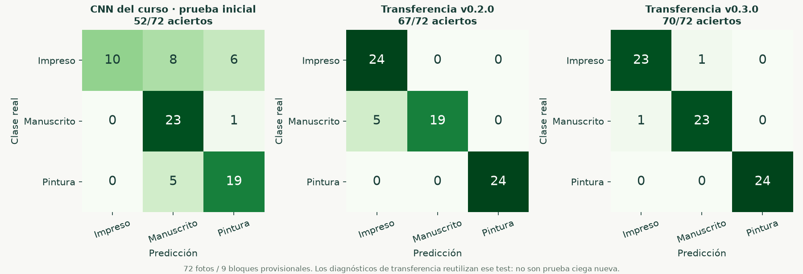

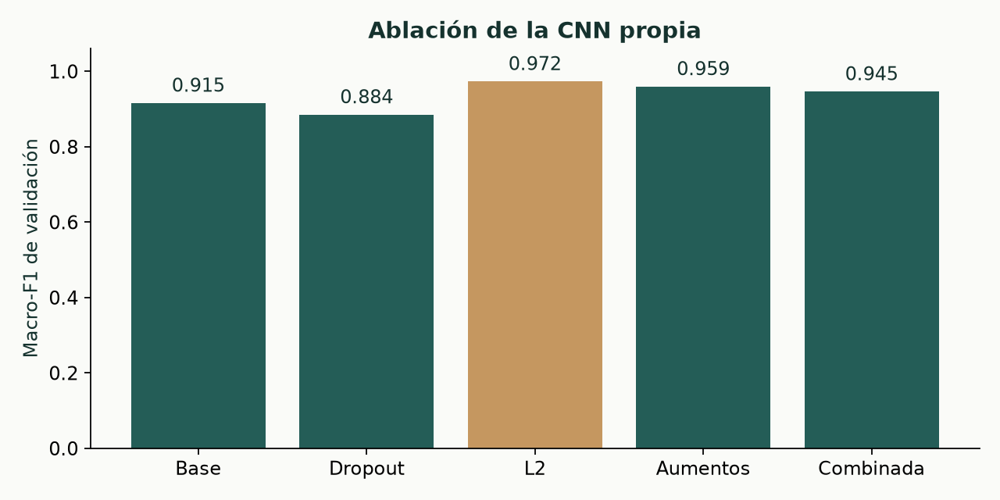

**Análisis.** La CNN entrenada desde cero con unas 340 fotos no logra separar bien impresos de manuscritos y pinturas (10 de 24 impresos acertados): con tan pocos datos memoriza el fondo y la luz. La regularización (L2, Dropout, aumentos) mejora la validación, pero no basta. La transferencia aprovecha rasgos aprendidos en ImageNet y solo entrena la última capa, lo que reduce mucho el riesgo de sobreajuste. El error que se repite es **manuscrito sugerido como impreso** en documentos con letra muy regular. Por eso la interfaz siempre pide confirmar la clase.

### Experimento de rotación (v0.2.0 → v0.3.0)

**Hipótesis.** La v0.2.0 caía de 0,93 a 0,80 de macro-F1 cuando la foto llegaba girada 90°. Entrenar la cabeza también con giros rectos debería corregirlo sin empeorar las fotos derechas.

**Regla de adopción, fijada antes de ejecutar** (`results/rotation/protocol.json`): en validación cruzada por bloques, macro-F1 en fotos derechas ≥ base − 0,01; recall ≥ 0,80 en cada clase; y macro-F1 medio en fotos giradas ≥ base + 0,05.


| Variante | C | Macro-F1 OOF derechas | Macro-F1 OOF giradas (media 90/180/270°) | ¿Cumple la regla? |
|---|---:|---:|---:|---|
| Base (v0.2.0) | 0,01 | 0,953 | 0,880 | — |
| **Giros de la vista original (v0.3.0)** | 0,1 | **0,958** | **0,955** | ✅ elegida |
| Giros de todas las vistas | 0,01 | 0,956 | 0,960 | ✅ |

La variante base reproduce exactamente la cifra publicada (0,9531), lo que confirma que el experimento usa el mismo encoder y los mismos folds. El modelo anterior se conserva en `models/classifier_v0.2.0.pt`. Script: `scripts/experiment_rotation.py`.

### Robustez a perturbaciones


Con giro de 90°, la v0.3.0 pasa de 0,798 a 0,958. Al aclarar un 25 %, en cambio, baja de 0,972 a 0,958: un error más. Son perturbaciones sintéticas sobre fotos ya vistas, no fotos nuevas. La clasificación tarda una mediana de 56 ms en CPU.

### Detección del borde

**Línea base: U-Net del tercer parcial (solo documentos impresos).**

| Método (fotos de documentos impresos con máscara de referencia) | Fotos | Detecta | IoU media del cuadrilátero | IoU ≥ 0,95 |
|---|---:|---:|---:|---:|
| Canny (50, 150) + cierre + cuadrilátero mayor | 80 | 25 | 0,28 | 16 |
| Canny con varios umbrales + puntuación de bordes | 80 | 69 | 0,64 | 32 |
| U-Net del parcial + cuadrilátero, fotos de prueba | 12 | 12 | 0,968 (Dice de máscara 0,993) | 11 |
| U-Net del parcial + cuadrilátero, las 80 (incluye las 56 de entrenamiento) | 80 | 80 | 0,969 | 68 |

Los métodos clásicos no se entrenan, así que se miden sobre las 80 fotos. La cifra justa de la U-Net es la de las 12 fotos de prueba, porque la fila de 80 incluye fotos que vio durante el entrenamiento. Esa U-Net se entrenó solo con impresos: en pinturas su máscara apenas coincidía con la pieza (Dice 0,59 en prueba), así que la v0.3.0 proponía el borde de las pinturas con contornos.

### Ampliación de la U-Net a manuscritos y pinturas (v0.3.0 → v0.4.0)

**Hipótesis.** Entrenar la misma U-Net con impresos, manuscritos y pinturas mejora el borde que propone Palimpsesto en manuscritos y pinturas, sin empeorar los impresos.

**Datos y entrenamiento.** Se anotaron con polígonos en makesense.ai 80 fotos de manuscritos y 80 de pinturas, elegidas entre las 160 de cada clase: piezas de borde recto (sin bordes quemados o rasgados), con la pieza completa y nítida. En las pinturas la máscara incluye el marco. Con los 80 impresos del parcial suman 240 fotos. La partición es **por pieza** (`data/segmentation_manifest.csv`): 160 de entrenamiento, 40 de validación y 40 de prueba, y los impresos conservan exactamente la prueba del parcial. Se usó la **misma receta del tercer parcial**: encoder ResNet18 ImageNet, 256×256, volteo y giro de hasta 12°, pérdida Soft Dice, Adam 5·10⁻⁴, 35 épocas y el checkpoint con menor pérdida de validación. Tarda poco más de un minuto en una GPU portátil.

**Regla de adopción, fijada antes de entrenar** (`results/segmentation/protocol.json`). Se compara con lo que hacía la v0.3.0 en modo automático: U-Net de impresos en impresos y manuscritos, y contornos en pinturas. La U-Net nueva debía cumplir cuatro condiciones en las fotos de prueba. Primera, una IoU media de las 3 clases de al menos +0,03. Segunda, que ninguna clase bajara más de 0,01. Tercera, que propusiera borde en al menos tantas fotos como antes. Cuarta, que la mejora media se mantuviera con 3 semillas. **Se cumplieron las cuatro.**

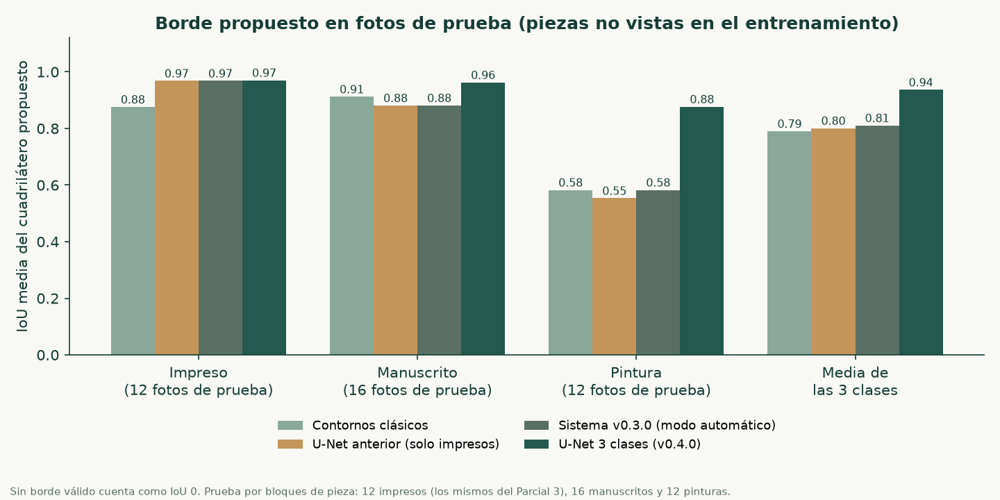

| Sistema · 40 fotos de prueba de piezas no vistas | Impreso (12) | Manuscrito (16) | Pintura (12) | Media de las 3 clases |
|---|---:|---:|---:|---:|
| Contornos clásicos | 0,876 | 0,912 | 0,583 | 0,790 |
| U-Net del parcial (solo impresos) en todas las clases | 0,968 | 0,881 | 0,553 | 0,801 |
| Sistema v0.3.0 en modo automático | 0,968 | 0,881 | 0,583 | 0,811 |
| **U-Net de 3 clases (v0.4.0, desplegada)** | **0,970** | **0,963** | **0,877** | **0,937** |

*IoU media del cuadrilátero que propone la aplicación (`imaging.detect_quad`, 960 px) frente a la máscara de referencia. Si no hay borde válido, cuenta como 0.*

| Detalle en prueba: v0.3.0 → v0.4.0 | Impreso | Manuscrito | Pintura |
|---|---|---|---|
| Fotos con borde propuesto | 12 → 12 | 16 → 16 | 10 → **12** |
| Fotos con IoU ≥ 0,90 | 12 → 12 | 11 → **15** | 5 → **7** |
| Dice de la máscara a 256 px (U-Net del parcial → U-Net nueva) | 0,993 → 0,994 | 0,941 → **0,975** | 0,589 → **0,933** |
| Semillas 42 / 7 / 2026 (IoU media del borde) | 0,970 / 0,966 / 0,972 | 0,963 / 0,923 / 0,967 | 0,877 / 0,818 / 0,833 |

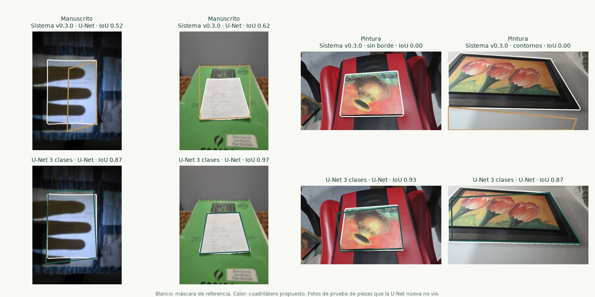

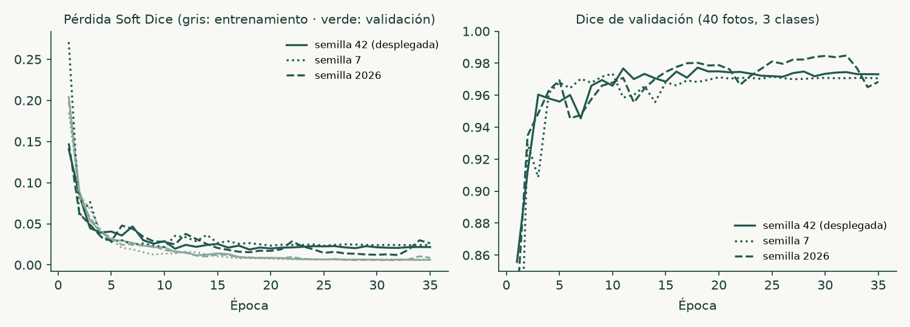

**Análisis.** La mayor ganancia está donde la v0.3.0 era más débil. En pinturas, la U-Net nueva propone borde en las 12 fotos, y en cuatro de ellas pasa de no tener un borde útil (IoU entre 0 y 0,37) a 0,55–0,94. En manuscritos corrige casos con sombras de mano o sobre fondos verdes, y pasa de 11 a 15 fotos con IoU ≥ 0,90. En impresos no empeora (0,968 → 0,970). Con las otras dos semillas, la media de las 3 clases queda entre 0,902 y 0,937 (media 0,921 ± 0,014), siempre por encima de la v0.3.0 (0,811). El tiempo no cambia: 49 ms de mediana en CPU. La validación deja de mejorar hacia la época 18 y ese es el checkpoint elegido; en esa época la pérdida de entrenamiento es 0,009 y la de validación 0,019, una brecha moderada.

**Límites de esta evaluación.** Son 40 fotos de prueba de 8 piezas o bloques (3 de impresos, 2 de manuscritos y 3 de pinturas), así que cada cifra depende de pocas piezas. Las pinturas siguen siendo la clase más difícil. Un lienzo sin marco, de tonos rojos y fotografiado sobre una silla roja (bloque PIN008), baja su media porque casi no contrasta con el fondo; solo 4 de 12 pinturas superan IoU 0,95. Los manuscritos elegidos tienen bordes rectos: con bordes rasgados o quemados la reducción a cuatro esquinas es una aproximación. Por eso los cuatro puntos siguen siendo editables y los contornos y el modo manual siguen disponibles.

### ¿Cuándo dudar del borde? Confianza del borde y máscara visible

**Qué resuelve.** La U-Net siempre entrega cuatro puntos, aunque se equivoque, y la persona no sabía cuándo desconfiar. Ahora la app mide dos cosas sin necesitar una referencia. Primero, **cuánto encajan los cuatro puntos con la máscara de la propia red** (IoU entre ambos). Segundo, **qué tan difuso es el contorno de la máscara** (ancho medio de la franja con probabilidad entre 0,1 y 0,9). Si el encaje es < 0,92 o la franja supera 5 px, el borde es **dudoso**: la app muestra la máscara y explica el motivo.

**Cómo se comprobó** (`scripts/evaluate_border_confidence.py`, `results/border_confidence/`). Se usó la misma función de la aplicación sobre las fotos con máscara de referencia; un borde es malo si su IoU real es < 0,90. Los umbrales se eligieron solo con las fotos de **validación** y se midieron en las de **prueba**. Además de la U-Net desplegada se usaron las de control (semillas 7 y 2026) para tener más casos.

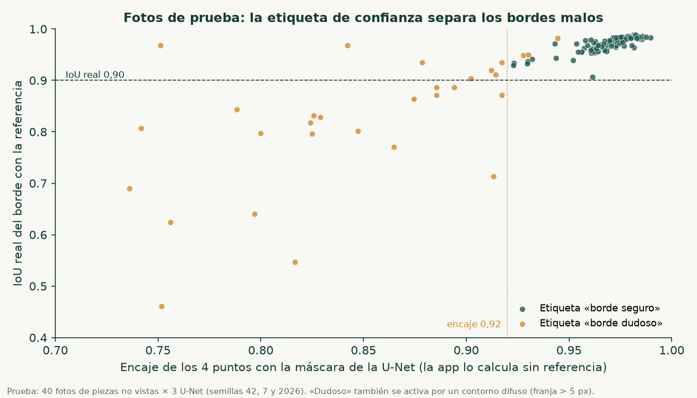

| Fotos de piezas no vistas | Bordes malos marcados «dudoso» | Bordes buenos marcados «dudoso» | Bordes malos entre los «seguros» |
|---|---:|---:|---:|
| Validación (elección de umbrales), 3 U-Net | 14 de 15 | 8 de 105 | 1 |
| **Prueba, 3 U-Net** | **21 de 21** | **10 de 98** | **0** |
| **Prueba, U-Net desplegada** | **6 de 6** | **5 de 34** | **0** |

En prueba, los bordes «seguros» tienen IoU media de 0,970 y los «dudosos», de 0,824. Por clase, los 36 bordes de impresos fueron seguros y correctos. En manuscritos se marcaron dudosos los 4 malos y 4 de 44 buenos; en pinturas, los 17 malos y 6 de 18 buenos.

**En las 480 fotos de clasificación**, que no tienen referencia, marca dudosos 16 de 160 impresos, 47 de 160 manuscritos y 71 de 160 pinturas. Esas fotos incluyen las capturas difíciles que se dejaron fuera del dataset de segmentación: cuadros cortados, sombras de mano y perspectivas extremas. Se revisó a ojo una muestra de 32 pinturas «dudosas»: unas 20 tenían el borde realmente mal, unas 6 estaban en el límite y unas 6 eran falsas alarmas. Una falsa alarma cuesta poco (mirar la máscara y confirmar); una omisión cuesta un recorte equivocado.

**Límites.** La regla se eligió con 120 bordes de validación y se probó con 119, de pocas piezas. La etiqueta mide la coherencia interna de la red, no la verdad: si la red se equivoca con seguridad y con un contorno nítido, el borde puede salir «seguro». No ocurrió en prueba, pero es posible. Contornos y modo manual no tienen etiqueta: siempre piden revisión.

### Calidad de la mejora (referencia sintética alineada)

| Caso | Sin mejora: PSNR / SSIM | Preajuste de impreso: PSNR / SSIM | Mejor técnica individual |
|---|---|---|---|
| Página limpia | ∞ / 1,000 | 33,6 / 0,997 | Hacer nada es lo correcto; los ajustes en cero conservan los píxeles |
| Sombra | 10,5 / 0,883 | 11,0 / 0,908 | Iluminación: SSIM 0,914 |
| Ruido | 28,3 / 0,543 | 26,1 / 0,501 | Suavizado: SSIM 0,614 |
| Desenfoque | 19,6 / 0,835 | 19,8 / 0,843 | FFT *high-boost*: SSIM 0,853 |

No existe un ajuste universal: cada defecto pide una técnica distinta, y por eso la mejora es ajustable y reversible. En fotos reales no hay referencia limpia, así que **la interfaz no inventa SSIM ni PSNR**: los muestra como no disponibles y usa nitidez y contraste solo como descriptores.

### Histograma y tonos recortados

**Qué resuelve.** Las métricas de nitidez y contraste suben con cualquier ajuste, así que no dicen si el ajuste destruyó información. El histograma de luminancia (clase S5 del curso) muestra cómo se redistribuyen los tonos. Además, la app cuenta **píxel a píxel cuántos llevó el ajuste a negro (≤ 2) o blanco (≥ 253) puros, que antes no lo eran**: ese detalle ya no se recupera. Si pasa del 1 % de la imagen, lo avisa y puede marcar dónde en el «después». En la versión en blanco y negro (Otsu/Sauvola) el recorte es intencional y no se cuenta.

**Cómo se comprobó** (`scripts/evaluate_tones.py`, `results/tones/`). Se tomaron 240 fotos reales (80 por clase), se rectificaron con el borde de la U-Net y se aplicaron seis ajustes con la función de la aplicación:

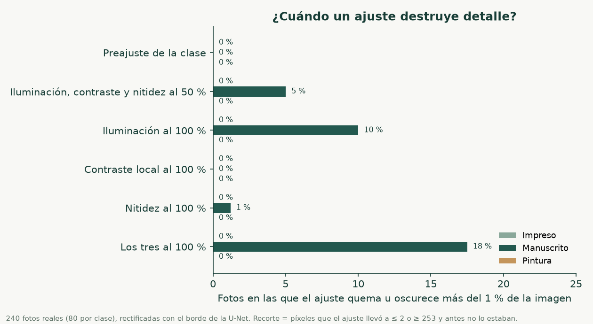

| Ajuste (240 fotos) | Fotos con aviso | Recorte máximo |
|---|---:|---:|
| Preajuste de cada clase | **0** | 0,45 % |
| Iluminación, contraste y nitidez al 50 % | 4 (todas manuscritos) | 2,7 % |
| Iluminación al 100 % | 8 (todas manuscritos) | 5,4 % |
| Contraste local (CLAHE) al 100 % | 0 | 0,03 % |
| Nitidez al 100 % | 1 | 1,0 % |
| Los tres al 100 % | 14 (todas manuscritos, 18 % de ellos) | 5,4 % |

**Análisis.** Es una buena noticia para el diseño: con los preajustes ninguna foto pierde detalle por recorte, y CLAHE nunca recorta gracias a su límite de amplificación. El riesgo está en **uniformar la iluminación al máximo en manuscritos**. La división por el fondo estimado quema la hoja cerca de bordes oscuros o quemados. En el peor caso quedó quemada la última palabra escrita junto al borde, justo donde la marca magenta la señala. Ahí el aviso aporta: dice cuánto, dónde y qué control bajar.

**Límites.** El aviso mide solo el recorte a negro o blanco puros. No detecta otras pérdidas, como compresión de tonos medios, halos o ruido amplificado. El umbral del 1 % es una convención, no una medida de legibilidad. Se calcula sobre la vista de 960 px.

### Semáforo de la captura

**Qué resuelve.** El escenario de uso pide saber *antes de salir de la sala* si la foto sirve. Antes había tres avisos genéricos calculados sobre la foto entera, fondo incluido, con umbrales fijos. El semáforo mide **la pieza**: usa la máscara de la U-Net y revisa cinco puntos.

| Chequeo | Medida | Amarillo (revisar) | Rojo (repetir) |
|---|---|---|---|
| Nitidez | Segunda derivada en *x* y en *y* por bloques de 48 px (vista de 960 px); se toma la dirección más pobre | < 20 en documentos, < 12 en pinturas, o una dirección 10 veces más nítida que la otra (temblor) | < 8 |
| Luz | Percentil 95 de la luminancia de la pieza; % saturado | percentil 95 < 70 | percentil 95 < 40, o ≥ 10 % de la pieza quemada |
| Reflejos | Mayor mancha saturada y compacta dentro de la pieza | ≥ 1,2 % de la pieza | — |
| Pieza completa | Contacto de la máscara con un lado de la foto | > 5 % del lado | > 25 % del lado |
| Tamaño | Fracción del encuadre y lado menor de la pieza en píxeles | < 10 % del encuadre, o < 450 px de lado | — |

**Cómo se calibró y se comprobó** (`scripts/evaluate_capture.py`, `results/capture/`). Los umbrales se eligieron observando las 480 fotos reales y versiones con defectos controlados. Tres decisiones salieron de revisar las fotos una por una:
- La **luz** se mide con el percentil 95 y no con la mediana: la tarjeta negra de letras amarillas está bien expuesta aunque su mediana sea baja.
- Los **reflejos** exigen una mancha compacta: el paspartú blanco de un cuadro no es un reflejo.
- El **tamaño** separa "acércate" de "la foto llegó comprimida por chat".

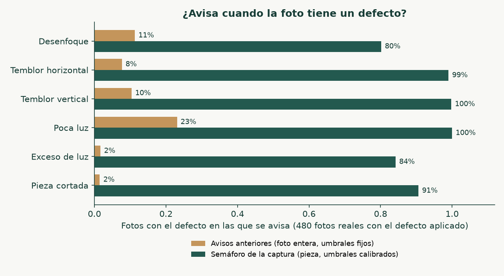

| Las 480 fotos con un defecto aplicado | Avisos anteriores | Semáforo |
|---|---:|---:|
| Desenfoque (gaussiano σ = 1,4 a 960 px) | 11 % | **80 %** |
| Temblor horizontal / vertical (11 px) | 8 % / 10 % | **99 % / 100 %** |
| Poca luz (× 0,28) | 23 % | **100 %** |
| Exceso de luz (× 2,3) | 2 % | **84 %** |
| Pieza cortada (se quita un 25 % de la pieza) | — (no existía) | **91 %** |

**En las fotos reales:**
- **Veredictos.** 376 quedan en verde, 81 en amarillo y 23 en rojo.
- **Revisión visual.** Se revisaron a ojo las 23 en rojo: todas están borrosas, muy oscuras o tienen la pieza cortada. Los avisos anteriores solo detectaban 5 de ellas. En las amarillas, casi todas tienen un motivo visible; los pocos avisos dudosos son pinturas muy lisas.
- **Pieza completa contra la máscara de referencia.** En las 80 fotos de validación y prueba que la U-Net no vio, avisó en las 5 que tocan el borde, con 1 falsa alarma. En las 240, 19 de 21.

**Límites.** No es una prueba ciega: los umbrales se ajustaron mirando estas mismas fotos. Los defectos son sintéticos y se aplican a la vista de 960 px. Una pintura muy lisa puede recibir un aviso amarillo de nitidez. Sin la U-Net, el semáforo mide la foto entera y omite los chequeos de encuadre y tamaño. El veredicto orienta; la persona decide.

### Control de alcance

El control de alcance avisa cuando la foto no parece un impreso, un manuscrito o una pintura plana. La primera versión (v0.4.0) comparaba la foto con las de entrenamiento por similitud. Alertó en 9 de 10 imágenes públicas ajenas (gato, monedas, cohete…), pero diez ejemplos de conveniencia no representan las entradas reales. Por eso se tomaron 30 fotos propias de cosas que no son piezas y se congelaron antes de ejecutar el modelo (`results/scope/external_negatives_v1_protocol.json`).

| Prueba externa v1 | Alertados | No alertados | Sensibilidad a negativos |
|---|---:|---:|---:|
| Escenas | 3/10 | 7/10 | 30,0 % |
| Objetos tridimensionales | 8/10 | 2/10 | 80,0 % |
| Negativos difíciles | 2/10 | 8/10 | 20,0 % |
| **Total** | **13/30** | **17/30** | **43,3 %** |

El filtro detectaba bien los objetos tridimensionales, pero dejaba pasar escenas y superficies parecidas a documentos o cuadros: una planta, un refrigerador, una tableta apagada, empaques, una fotografía enmarcada. El clasificador podía asignarles una clase con puntuación alta; esa puntuación **no demuestra que estén dentro del alcance**. La regla fijada antes de la prueba pedía al menos 24/30, así que el resultado (13/30) se registró como insuficiente y motivó la v2. Esas 30 fotos nunca se usaron para ajustar.

### Evolución del control de alcance

La historia del control se conserva completa, incluidos los resultados desfavorables. El detalle está en la bitácora [`docs/PROGRESO_CONTROL_ALCANCE.md`](docs/PROGRESO_CONTROL_ALCANCE.md).

| Versión / iteración | Datos | Negativos alertados | Piezas válidas aceptadas | Tipo de evidencia | Decisión |
|---|---|---:|---:|---|---|
| v0.4.0 · similitud top-3 (foto entera) | 10 imágenes públicas de conveniencia | 9/10 | 72/72 (diagnóstico) | Exploratoria, pocos ejemplos | Desplegada |
| v0.4.0 · prueba externa v1 | 30 negativos propios congelados | **13/30 (43 %)** | — | Prueba externa | Insuficiente; motivó la v2 |
| v2 · desarrollo, mismos rasgos de foto entera | 408 válidas + 88 negativos nuevos | 41–46/88 | 395/408 | Validación cruzada por grupos | Ningún método supera la línea base |
| v2 · desarrollo, recorte de la pieza + regresión logística | 408 válidas + 88 negativos nuevos | 79/88 (90 %) | 395/408 (97 %); 72/72 en regresión | Solo desarrollo | Cumple la puerta; congelado (`b3a7ad1`) |
| **v2 · prueba ciega** | 18 negativos nunca vistos | **16/18 (89 %)** · escenas 6/6, objetos 6/6, difíciles 4/6 | **72/72** en regresión | **Prueba ciega única** | **Adoptado** (v2 desplegada) |

**Problema observado.** En la prueba externa v1 el filtro v0.4.0 alertó 8/10 objetos tridimensionales, pero solo 3/10 escenas y 2/10 negativos difíciles. Las piezas válidas y las fotos ajenas se tomaron en los mismos interiores (pisos, sofás y mesas), y la pieza ocupa en promedio un 38 % de la foto. Los rasgos de la foto entera describen sobre todo el fondo.

**Hipótesis.** Si se mira **la pieza y no la escena**, un clasificador lineal sencillo debería separar mejor. Para eso se recorta con la U-Net, que ya existe, la caja de su mayor región (+5 %) antes de calcular los rasgos.

**Datos y separación.**
- **Ajuste:** las 408 fotos válidas de desarrollo (41 bloques de pieza) y **88 negativos nuevos de desarrollo** (21 escenas, 52 objetos 3D, 15 negativos difíciles). Los negativos se agruparon a ojo en 47 identidades: misma mesa, sofá, taller o tienda (`data/scope_negatives_dev_v2.csv`).
- **Validación:** cruzada en 5 folds sin repartir piezas ni identidades.
- **Regresión positiva:** las 72 fotos de diagnóstico, que son un conjunto reutilizado y no una prueba ciega.
- **Referencia:** los 30 negativos v1 solo se informan, porque ya estaban abiertos y no ajustaron nada.
- **Prueba ciega v2:** 18 imágenes que no se abrieron, ni listaron, ni evaluaron durante el desarrollo.

**Métodos comparados.** Todos usan los rasgos del encoder ResNet18 del clasificador. Se compararon la similitud de la v0.4.0, una regresión logística (pieza válida o no) y la distancia de Mahalanobis, cada uno sobre la foto entera y sobre el recorte de la pieza. Para que la comparación sea justa, todos usan el mismo umbral: el que acepta el 97 % de las piezas válidas.

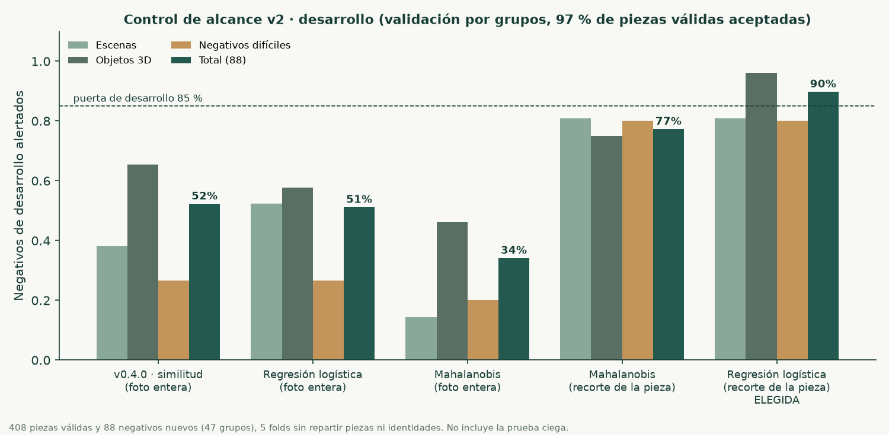

| Desarrollo (fuera de fold) | Negativos alertados | Escenas | Objetos 3D | Difíciles | Válidas aceptadas | Peor clase |
|---|---:|---:|---:|---:|---:|---:|
| v0.4.0 · similitud (foto) | 46/88 | 8/21 | 34/52 | 4/15 | 395/408 | 93,4 % |
| Regresión logística (foto), mejor C | 45/88 | 11/21 | 30/52 | 4/15 | 395/408 | 91,9 % |
| Mahalanobis (foto) | 30/88 | 3/21 | 24/52 | 3/15 | 395/408 | 92,6 % |
| Mahalanobis (recorte) | 68/88 | 17/21 | 39/52 | 12/15 | 395/408 | 91,2 % |
| **Regresión logística (recorte), C = 10** | **79/88** | **17/21** | **50/52** | **12/15** | **395/408** | **90,4 %** |
| Regresión (recorte + máscara), mejor C | 80/88 | 17/21 | 50/52 | 13/15 | 395/408 | 91,2 % |

**Regla de adopción, fijada antes de abrir la prueba ciega** (`results/scope_v2/protocol_blind.json`).
- **Puerta de desarrollo:**
  - al menos 85 % de negativos alertados;
  - al menos 95 % de piezas válidas aceptadas y al menos 90 % en cada clase;
  - una mejora clara frente a la v0.4.0;
  - funcionamiento en CPU.
- **Elección:** si dos métodos cumplen, se conserva el más sencillo.
- **Prueba ciega, una sola vez:**
  - al menos 15/18 negativos alertados;
  - al menos 4/6 en cada grupo;
  - al menos 95 % de aceptación en la regresión positiva.
- **No se reajusta después de verla.**

**Resultado de desarrollo.** La regresión logística sobre el recorte cumple la puerta y es la opción más sencilla que lo hace: una capa lineal de 512 pesos sobre rasgos que la app ya calcula, más unos 33 ms en CPU. Frente a la v0.4.0 con la misma aceptación de válidas, pasa de 46/88 a 79/88. En la regresión positiva acepta 72/72. El recorte + máscara también cumple, pero no aporta lo suficiente para justificar su complejidad. Método, umbral (0,306) y regla quedaron congelados en un commit (`b3a7ad1`) antes de abrir la prueba ciega.

**Impacto en piezas válidas.** Impresos y manuscritos se aceptan 136/136. Las 13 válidas rechazadas son pinturas: 10 de ellas de **un solo cuadro** (el jarrón alto y angosto, bloque PIN010, fotos comprimidas por chat) y 3 de otros dos cuadros. La confirmación manual se conserva: un rechazo solo pide confirmar que la foto es una pieza admitida.

**Resultado ciego (una sola ejecución, `results/scope_v2/blind.json`).** El control v2 alertó **16/18** negativos nunca vistos: 6/6 escenas, 6/6 objetos tridimensionales y 4/6 negativos difíciles. En la regresión positiva aceptó **72/72**. Cumple las tres condiciones de la regla, aunque los negativos difíciles quedan **justo en el mínimo (4/6)**.

Un primer intento se detuvo al cargar una imagen de más de 40 MP, antes de producir ninguna predicción. Solo se corrigió el cargador del script (enmienda registrada en el protocolo); el método y el umbral no cambiaron.

**Decisión: adoptar.** La v2 queda desplegada. **Mejora confirmada en prueba ciega**: frente al 43 % de la v0.4.0 en la prueba externa v1 (13/30), la v2 alertó el 89 % de una prueba ciega nueva (16/18). No son el mismo conjunto, así que la comparación es orientativa. **La confirmación manual se conserva**: el control avisa y la persona decide.

**Limitaciones.** La prueba ciega tiene solo 18 imágenes, y los negativos difíciles quedaron en el mínimo (4/6): objetos planos y rectangulares que parecen documentos o cuadros siguen siendo el punto débil. Los datos provienen de pocos hogares y tiendas. Pinturas poco comunes pueden rechazarse; en desarrollo la peor clase quedó en 90,4 %, casi toda por un solo cuadro alto y angosto. Las 72 fotos de regresión son un conjunto reutilizado. Ninguna prueba demuestra un detector universal de objetos desconocidos.

### Pruebas del sistema

| Conjunto | Resultado |
|---|---|
| `python scripts/check.py`: transformaciones, original intacto, errores, sesión, concurrencia, exportación, acceso remoto, descarga verificada de pesos, semáforo de la captura, confianza del borde, histograma, tonos recortados y control de alcance v2 | 113/113 |
| `scripts/verify_real_pipeline.py`: 9 recorridos completos con los modelos reales (3 por clase) | 9/9 exportan PNG/PDF/JSON/ZIP con el original intacto |
| `npm run test:ui`: navegador en 320–1440 px, semáforo de la captura, confianza del borde y máscara, histograma, avisos, fallos de red, reintentos, diálogos, celular con la página desplazada, movimiento reducido | 25/25 |
| Matriz de entradas inválidas y recuperación | `docs/VALIDACION_Y_FALLOS.md` |

Las pruebas automáticas verifican los contratos del software. La evaluación experimental del modelo se describe por separado, con sus protocolos y limitaciones.

---

## 8. Conclusiones

**Principales resultados**

- Se construyó un sistema funcional de extremo a extremo (cargar → identificar → encuadrar → mejorar → exportar) que integra clasificación, segmentación y PDI clásico, corre en CPU sin conexión y conserva el original byte a byte.
- En las mismas 72 fotos de diagnóstico, el clasificador por transferencia (ResNet18) acertó 70 y la CNN del curso 52. En validación cruzada por bloques, el clasificador obtuvo macro-F1 0,958.
- Un experimento con hipótesis y regla fijadas de antemano corrigió la debilidad ante fotos giradas (0,880 → 0,955 de macro-F1 en validación cruzada) sin empeorar las fotos derechas.
- La U-Net hizo confiable la detección del borde en documentos (IoU 0,968 en fotos de prueba, frente a 0,64 de los contornos clásicos). Al reentrenarla con 160 máscaras nuevas de manuscritos y pinturas, con una regla de adopción fijada de antemano, el borde propuesto en prueba subió de 0,811 a 0,937 de IoU media (pinturas 0,583 → 0,877; manuscritos 0,881 → 0,963) sin empeorar los impresos.
- La interfaz pone a la persona en el centro: confirma la clase, corrige el borde, ve el efecto de cada ajuste y recibe avisos claros con la forma de recuperarse.
- El histograma del paso 4 muestra el efecto real de cada ajuste en los tonos. Con los preajustes ninguna de 240 fotos pierde detalle por recorte; cuando un ajuste extremo quema detalle (sobre todo iluminación alta en manuscritos), la app lo dice y marca dónde.
- La etiqueta de confianza del borde avisa cuándo dudar de la U-Net: en las fotos de prueba marcó como dudosos los 21 bordes malos (6 de 6 con la U-Net desplegada), y ningún borde «seguro» resultó malo. La máscara superpuesta muestra en qué se basó la red.
- El semáforo de la captura lleva a la práctica el escenario de uso: dice en el momento si conviene repetir la foto. Frente a los avisos anteriores, detecta defectos controlados en el 80–100 % de los casos (antes 2–23 %) y marcó en rojo las 23 fotos reales que lo merecían, de las que antes se detectaban 5.
- La prueba externa de alcance identificó 13/30 entradas ajenas con la v0.4.0. Ese resultado negativo llevó a una nueva iteración: mirar la pieza recortada por la U-Net en lugar de la foto entera. Con una regresión logística sobre esos rasgos, el control v2 alertó 79/88 negativos de desarrollo y **16/18 en una prueba ciega nueva**, aceptando 72/72 piezas válidas de regresión. Se adoptó con una regla fijada antes de ver la prueba.

**Limitaciones**

- Las identidades físicas de las piezas no están certificadas y el diagnóstico de 72 fotos ya se había usado, así que **las métricas son provisionales y no prueban generalización a piezas nuevas**.
- Manuscritos de letra muy regular todavía se confunden con impresos. La U-Net acierta menos en pinturas que en documentos (IoU 0,877 frente a 0,96–0,97), sobre todo cuando la pintura y el fondo tienen colores parecidos, y su prueba tiene solo 8 piezas o bloques.
- No hay referencia real para medir la fidelidad de la mejora; la homografía no corrige páginas curvas.
- El control de alcance v2 detectó 16/18 negativos ciegos, pero solo 4/6 de los difíciles (objetos planos parecidos a documentos o cuadros) y la prueba es pequeña. Es una barrera de advertencia, no un detector universal; la confirmación humana sigue siendo obligatoria.

**Oportunidades de mejora**

- Certificar las piezas y capturar 6–9 piezas nuevas para una evaluación realmente independiente.
- Anotar más pinturas sobre fondos de colores parecidos y manuscritos de borde irregular, para seguir ampliando la U-Net.
- Ajustar el modelo completo (*fine-tuning*) una vez exista una partición certificada.
- Reunir más negativos difíciles (objetos planos y rectangulares) y pinturas poco comunes para el control de alcance, y comprobarlo en un tercer conjunto ciego nuevo (los conjuntos v1 y v2 ya están abiertos).
- Incorporar dewarping para páginas curvas y OCR como herramienta externa de evaluación.

---

## 9. Instalación y ejecución

Entorno comprobado: Python 3.12, PyTorch 2.15 CPU, en Windows (equipo de desarrollo) y Linux (revisión). No requiere GPU ni conexión a Internet para la inferencia.

```powershell
py -3.12 -m venv .venv
.\.venv\Scripts\python.exe -m pip install --upgrade pip
.\.venv\Scripts\python.exe -m pip install torch==2.15.0 torchvision==0.29.2 --index-url https://download.pytorch.org/whl/cpu
.\.venv\Scripts\python.exe -m pip install -r requirements.txt
```

**Los pesos se instalan solos.**
- Al iniciar, `palimpsesto/weights.py` comprueba los pesos por SHA-256. Si faltan o son de otra versión, descarga `modelos_palimpsesto_v0.4.0.zip` de la [release v0.4.0](https://github.com/juanffff-hub/palimpsesto-pdi/releases/tag/v0.4.0) (236 MB, solo la primera vez), lo verifica y lo extrae en `models/`.
- Sin conexión no se borra nada: la app arranca con los pesos que haya. También se puede hacer a mano con `python scripts/fetch_models.py`.
- Pesos que se descargan: `classifier.pt` y `unet_resnet18_3clases.pth`. El control de alcance (`scope_head.npz` y `scope_reference.npz`) viene en el repositorio. Los hashes están en `models/checksums.json`.
- El ZIP trae además los modelos anteriores (CNN del curso, clasificador v0.2.0 y U-Net del parcial) para reproducir las comparaciones.
- Para abrir la aplicación bastan el código, el entorno y los pesos. El dataset solo hace falta para reproducir los experimentos.

```powershell
.\.venv\Scripts\python.exe run.py
```

Abre **http://127.0.0.1:8765**. También puedes usar `Instalar_Palimpsesto.cmd` y `Iniciar_Palimpsesto.cmd`. Ctrl+C detiene el servidor. En Linux/macOS usa `.venv/bin/python`. El puerto se cambia con `PALIMPSESTO_PORT`. Este lanzador escucha solo en localhost. Para compartir una demo HTTPS gratuita, consulta «Demo compartida gratuita».

Si aun así faltan los pesos (por ejemplo, sin conexión la primera vez), la interfaz entra en **modo manual** (categoría y borde a mano), pero ese modo no demuestra el componente de IA. Para comprobarlo, `/api/status` debe devolver `classifier`, `segmenter` y `scope_screen` en `true`.

### Reproducir entrenamiento, evaluación y figuras

Usa los ZIP de las releases (sección 5):
- `--root` apunta a la carpeta `datos/` de `dataset_palimpsesto_v1.zip`.
- `--data` y `--seg` apuntan a `segmentacion_3clases/`; la carpeta `02_segmentacion_unet` del Drive también sirve.
- `scripts/build_segmentation_dataset.py` reconstruye la segmentación a partir de las fotos y las anotaciones de makesense.ai.

```powershell
.\.venv\Scripts\python.exe scripts/train_classifier.py --root "C:\ruta\datos"      # CNN del curso y ANN
.\.venv\Scripts\python.exe scripts/train_transfer.py --root "C:\ruta\datos"        # transferencia v0.2.0
.\.venv\Scripts\python.exe scripts/experiment_rotation.py --root "C:\ruta\datos"   # experimento v0.3.0 (añade --promote para desplegar)
.\.venv\Scripts\python.exe scripts/calibrate_scope.py --root "C:\ruta\datos"
.\.venv\Scripts\python.exe scripts/evaluate_model.py --root "C:\ruta\datos"
.\.venv\Scripts\python.exe scripts/evaluate_scope.py --root "C:\ruta\datos"
.\.venv\Scripts\python.exe scripts/evaluate_scope_external.py --data "C:\ruta\negativos_alcance_v1"  # prueba externa congelada; no recalibra
.\.venv\Scripts\python.exe scripts/develop_scope_v2.py --root "C:\ruta\datos" --neg "C:\ruta\01_desarrollo_negativos_v2" --save   # control de alcance v2 (desarrollo)
.\.venv\Scripts\python.exe scripts/make_scope_figures.py
.\.venv\Scripts\python.exe scripts/evaluate_capture.py --root "C:\ruta\datos" --seg "C:\ruta\segmentacion_3clases"   # semáforo de la captura
.\.venv\Scripts\python.exe scripts/evaluate_border_confidence.py --seg "C:\ruta\segmentacion_3clases" --root "C:\ruta\datos"   # confianza del borde
.\.venv\Scripts\python.exe scripts/evaluate_tones.py --root "C:\ruta\datos"   # histograma y tonos recortados
.\.venv\Scripts\python.exe scripts/benchmark_quality.py
.\.venv\Scripts\python.exe scripts/train_unet.py --data "C:\ruta\segmentacion_3clases" --seed 42 --save   # U-Net v0.4.0
.\.venv\Scripts\python.exe scripts/train_unet.py --data "C:\ruta\segmentacion_3clases" --seed 7          # semillas de control (también 2026)
.\.venv\Scripts\python.exe scripts/evaluate_unet.py --data "C:\ruta\segmentacion_3clases"
.\.venv\Scripts\python.exe scripts/make_segmentation_figures.py --data "C:\ruta\segmentacion_3clases"
.\.venv\Scripts\python.exe scripts/make_figures.py --root "C:\ruta\datos"
.\.venv\Scripts\python.exe scripts/verify_real_pipeline.py --root "C:\ruta\datos"
.\.venv\Scripts\python.exe scripts/check.py
```

**El entrenamiento sobrescribe checkpoints y resultados:** conserva una copia de la release antes de repetirlo. `experiment_rotation.py --promote` guarda siempre el modelo anterior como `classifier_v0.2.0.pt`. Después de cambiar el clasificador, ejecuta `calibrate_scope.py` y actualiza `models/checksums.json`. La U-Net se entrena en GPU si hay una disponible (en CPU tarda más, pero funciona). Las semillas fijas reducen la variación, pero no garantizan resultados idénticos bit a bit entre equipos.

**Pruebas de navegador:** con el servidor activo, `npm install` y `npm run test:ui` (Node y Chrome; `CHROME_PATH` es opcional). Las capturas del README se regeneran con `node scripts/capture_gui.cjs`.

---

## Cierre técnico y entregables

El repositorio reúne los ocho apartados documentales de la rúbrica y evidencia experimental con datos reales, métricas, ejemplos y análisis de limitaciones. Consulta la [matriz de cumplimiento](docs/CIERRE_RUBRICA.md).

**Póster académico (A3):** [PDF para imprimir](docs/poster/poster_palimpsesto_A3.pdf) · [PNG](docs/poster/poster_palimpsesto.png). Quedan el **video de máximo tres minutos** y la **sustentación oral**, incluida la demostración del funcionamiento.

[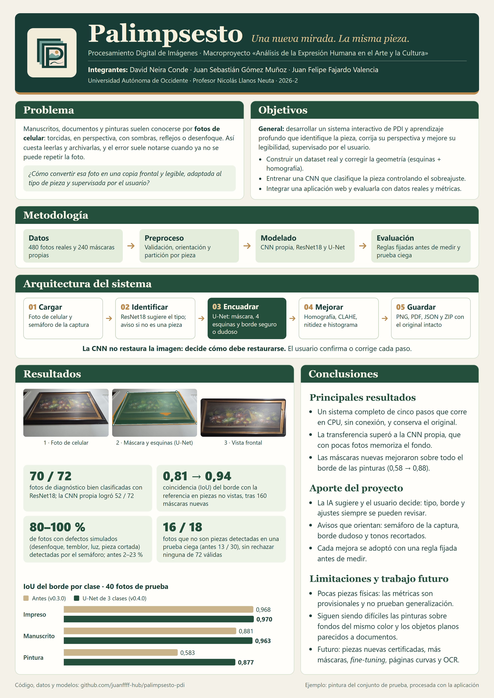](docs/poster/poster_palimpsesto_A3.pdf)

## Demo compartida gratuita

Ejecuta `Iniciar_Enlace_Publico.cmd` para obtener un enlace HTTPS sin cuenta ni tarjeta. Se publica la aplicación completa, con las dos redes y el control de alcance. El enlace aparece en la consola y en `.public_runtime/enlace.txt`. Para cerrarlo, usa `Detener_Enlace_Publico.cmd`.

El computador debe permanecer encendido y conectado. Es una demostración temporal: al reiniciar el túnel cambia la URL y no hay garantía de disponibilidad continua. Las fotos se procesan en el computador anfitrión a través de Cloudflare; las sesiones se eliminan tras 15 minutos sin actividad, con limpieza cada 30 segundos.

La demo se actualiza sola con los cambios de `main` cuando no hay sesiones activas. Detalle en [Operación y actualizaciones](docs/DEMO_PUBLICA.md).

## Referencias

- Canny, J. (1986). A computational approach to edge detection. *IEEE TPAMI, 8*(6), 679–698. https://doi.org/10.1109/TPAMI.1986.4767851
- Gonzalez, R. C., & Woods, R. E. (2018). *Digital image processing* (4.ª ed.). Pearson.
- Hartley, R., & Zisserman, A. (2004). *Multiple view geometry in computer vision* (2.ª ed.). Cambridge University Press.
- He, K., Zhang, X., Ren, S., & Sun, J. (2016). Deep residual learning for image recognition. *CVPR*, 770–778.
- Liang, J., Doermann, D., & Li, H. (2005). Camera-based analysis of text and documents: A survey. *IJDAR, 7*(2–3), 84–104. https://doi.org/10.1007/s10032-004-0138-z
- Otsu, N. (1979). A threshold selection method from gray-level histograms. *IEEE TSMC, 9*(1), 62–66.
- Ronneberger, O., Fischer, P., & Brox, T. (2015). U-Net: Convolutional networks for biomedical image segmentation. *MICCAI*, 234–241.
- Sauvola, J., & Pietikäinen, M. (2000). Adaptive document image binarization. *Pattern Recognition, 33*(2), 225–236.
- Srivastava, N., et al. (2014). Dropout: A simple way to prevent neural networks from overfitting. *JMLR, 15*(56), 1929–1958.
- UNESCO. (2003). *Carta sobre la preservación del patrimonio digital*.
- Wang, Z., Bovik, A. C., Sheikh, H. R., & Simoncelli, E. P. (2004). Image quality assessment: From error visibility to structural similarity. *IEEE TIP, 13*(4), 600–612.
- Zuiderveld, K. (1994). Contrast limited adaptive histogram equalization. En *Graphics gems IV* (pp. 474–485). Academic Press.
- Documentación: [OpenCV · homografía](https://docs.opencv.org/4.x/d9/dab/tutorial_homography.html), [PyTorch · transferencia](https://docs.pytorch.org/tutorials/beginner/transfer_learning_tutorial.html), [scikit-image · métricas](https://scikit-image.org/docs/stable/api/skimage.metrics.html), [scikit-learn · StratifiedGroupKFold](https://scikit-learn.org/stable/modules/generated/sklearn.model_selection.StratifiedGroupKFold.html).

**Derechos.** No se presupone una licencia pública para las fotografías, las obras ni el material docente. El código y los modelos se entregan para este proyecto académico; revisa las autorizaciones antes de redistribuir. Las bibliotecas y el preentrenamiento conservan sus propias licencias.

**Estado del proyecto.** `docs/ESTADO_PROYECTO.md` resume la versión, los comandos y las limitaciones para el mantenimiento del equipo.
