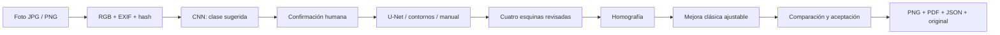

# Palimpsesto

**Una nueva mirada. La misma pieza.** Asistente local de PDI para mejorar fotografías de manuscritos, documentos impresos y pinturas planas. Proyecto académico de Neira, Gómez y Fajardo.

Carga una foto → confirma la clase sugerida por una CNN → revisa cuatro esquinas → corrige perspectiva y mejora → compara y exporta PNG/PDF/JSON con el original intacto. La inferencia ocurre en CPU; no requiere API ni GPU. La aplicación pide supervisión porque una imagen plausible no garantiza fidelidad documental.

## Estado comprobado

- Clasificador **real** ResNet18 congelada con cabeza entrenada sobre las fotografías del equipo. Pesos completos, preprocesamiento y manifiesto identificados por hash.
- CNN propia del curso, cinco variantes y ANN de descriptores entrenadas y conservadas como comparación.
- U-Net propia del tercer parcial cargada para sugerir bordes documentales. Contornos y cuatro puntos manuales como alternativas.
- Homografía sobre RGB original, controles reversibles, comparación de igual geometría, exportación PNG/PDF/JSON/ZIP y conservación exacta de bytes del original.
- Pruebas de funciones, API, modelos reales y navegador; evidencias en `results/` y protocolo en `docs/`.
- **Validación científica provisional:** falta confirmar identidades físicas de los grupos y realizar prueba externa/usabilidad humana. No se inventaron resultados humanos.

## Inicio rápido en Windows

Entorno comprobado: Python **3.12.14**, Windows, PyTorch CPU. Para una instalación nueva, usa Python 3.12 y abre PowerShell dentro de la carpeta del proyecto:

```powershell
py -3.12 -m venv .venv
.\.venv\Scripts\python.exe -m pip install --upgrade pip
.\.venv\Scripts\python.exe -m pip install torch==2.15.0 torchvision==0.29.2 --index-url https://download.pytorch.org/whl/cpu
.\.venv\Scripts\python.exe -m pip install -r requirements.txt
```

Descarga y extrae los pesos de la [release del proyecto](https://github.com/juanffff-hub/palimpsesto-pdi/releases/tag/v0.2.0) en la raíz. Deben existir `models/classifier.pt` y `models/unet_resnet18_imagenet.pth`. La release es privada y requiere acceso al repositorio.

```powershell
.\.venv\Scripts\python.exe run.py
```

Abre **http://127.0.0.1:8765**. También puedes ejecutar `Iniciar_Palimpsesto.cmd` una vez instalado. Ctrl+C detiene el servidor. En la copia preparada en el equipo original, el lanzador también reconoce las dependencias locales ya instaladas; una descarga nueva debe seguir la instalación anterior.

En Linux/macOS, crea `.venv` con Python 3.12 y utiliza `.venv/bin/python` en los comandos equivalentes. Esa ruta es compatible con el código, pero no se declara probada en ambos sistemas. Para cambiar el puerto, define `PALIMPSESTO_PORT`. El servidor escucha únicamente en localhost y está pensado para la demostración local, no para alojamiento público.

Si faltan pesos, la interfaz permite selección y borde manual, pero **ese modo no constituye una demostración del componente de IA**. Comprueba `/api/status`: `classifier`, `segmenter` y `scope_screen` deben ser `true` para demostrar todas las funciones de la entrega.

## Datos, pesos y acceso del docente

Los datos originales no se incluyen en el historial Git. La [release v0.2.0](https://github.com/juanffff-hub/palimpsesto-pdi/releases/tag/v0.2.0) ofrece `modelos_palimpsesto_v0.2.0.zip` para inferencia y `Palimpsesto_Claude_Code_COMPLETO.zip` con el proyecto, todos los originales y el contexto de continuidad. Los hashes de los pesos están en `models/checksums.json`. No muevas los archivos de imagen individualmente: el manifiesto conserva rutas relativas para reproducir la procedencia.

`data/manifest.csv` contiene 480 fotografías y las particiones nuevas; las etiquetas de carpeta antiguas no fijan el split. `group_verified=false` indica que la identidad física sigue sin certificarse. Los 50 bloques automáticos son conservadores y no equivalen a 50 objetos físicos confirmados. Revisa la herramienta HTML de la entrega antes de declarar evaluación final. No incluyas imágenes LoRA ni máscaras como fotografías independientes de prueba.

El repositorio privado debe compartirse con el docente o el equipo debe acordar otra vía de acceso. **Un enlace privado sin permisos no satisface el requisito de acceso.** Confirmar ese acceso es una tarea humana de entrega. Las imágenes contienen documentos identificables y obras; revisar su difusión antes de hacer público el repositorio o los archivos.

## Resultados y límites

| Experimento | Resultado | Alcance de la evidencia |
|---|---:|---|
| CNN del curso, L2 elegida por validación | 52/72 aciertos; macro-F1 0,7050 | Split provisional; mostró generalización insuficiente |
| ANN de 50 descriptores | 47/72 aciertos; macro-F1 0,6455 | Baseline del mismo split de la CNN |
| Transferencia, predicciones fuera de fold | 389/408 aciertos; macro-F1 0,9531 | 5 folds por 41 bloques; usada para seleccionar C; grupos pendientes |
| Transferencia, diagnóstico secundario | 67/72 aciertos; macro-F1 0,9298 | Test ya abierto con la CNN anterior; no es confirmación ciega nueva |
| U-Net, 12 fotos de prueba histórica | Dice 0,9931; IoU máscara 0,9864 | Dominio estrecho de documentos impresos; 256×256 |
| U-Net + cuadrilátero, mismas 12 | IoU media 0,9681; 11/12 ≥0,95 | Comparación con máscara a escala máxima 960 |

Los cinco errores del clasificador final son manuscritos sugeridos como impresos. En el diagnóstico de giros de 90° el rendimiento baja: consulta `results/robustness/evaluation.json`. Confirma siempre la clase y orienta la foto. Las perturbaciones sintéticas no son fotos nuevas independientes. No interpretar una puntuación softmax alta como certeza calibrada.

La comparación CNN/transferencia cambia preentrenamiento y cantidad de desarrollo: no aísla causalmente una sola mejora. No hay ground truth de mejora patrimonial real. Los experimentos de SSIM/PSNR usan referencias sintéticas alineadas; en fotos habituales la interfaz muestra esas métricas como no disponibles. Varianza del Laplaciano y contraste RMS son descriptores, no puntuaciones de fidelidad.

## Arquitectura y relación con el curso



`palimpsesto/models.py`: CNN propia, ResNet18 y U-Net; pesos cargados estrictamente con `weights_only=True`.

`palimpsesto/imaging.py`: RGB, homografía, filtros espaciales, estimación de iluminación, CLAHE, Otsu/Sauvola y descriptores. Derivadas y mezclas se calculan en flotante.

`palimpsesto/server.py`: API Flask local y sesiones aisladas. `templates/` y `static/`: interfaz de cinco pasos, canvas de esquinas con teclado, deshacer y comparación.

`palimpsesto/exporting.py`: registro de parámetros, esquinas, homografía, hash y original. `notebooks/Palimpsesto_experimentos.ipynb`: recorrido académico con FFT y evaluación. `docs/02_Investigacion_y_decisiones.md`: revisión del curso completo, antecedentes, alternativas y justificación del alcance.

Las pinturas empiezan sin mejoras. La binarización se limita a documentos. Una homografía supone una pieza plana; no corrige páginas curvas ni conoce medidas físicas sin información adicional. No se usa difusión para reconstruir letras, eliminar firmas o inventar textura.

## Reproducir entrenamiento y evaluación

El argumento `--root` apunta a la carpeta que contiene las rutas del manifiesto, por ejemplo la carpeta original del material o `material_original/Material Proyecto de PDI` dentro del paquete completo.

```powershell
.\.venv\Scripts\python.exe scripts/train_classifier.py --root "C:\ruta\datos"
.\.venv\Scripts\python.exe scripts/train_transfer.py --root "C:\ruta\datos"
.\.venv\Scripts\python.exe scripts/calibrate_scope.py --root "C:\ruta\datos"
.\.venv\Scripts\python.exe scripts/evaluate_model.py --root "C:\ruta\datos"
.\.venv\Scripts\python.exe scripts/benchmark_quality.py
.\.venv\Scripts\python.exe scripts/verify_real_pipeline.py --root "C:\ruta\datos"
.\.venv\Scripts\python.exe scripts/check.py
```

**El entrenamiento escribe nuevos checkpoints y resultados.** Conserva una copia de la release antes de repetir. El primer script establece una CNN del curso como `classifier.pt`; el segundo la reemplaza por transferencia solo si supera el criterio de CV registrado. En esta entrega lo superó. La primera ejecución de transferencia descarga los pesos ImageNet oficiales; la inferencia normal con los pesos finales funciona sin Internet. Semillas fijas reducen variación, pero no garantizan igualdad binaria entre hardware, versiones y plataformas.

Para revisar piezas: abrir el HTML de revisión, corregir IDs para que todas las vistas de la misma pieza compartan identidad, marcar solo fotos realmente inspeccionadas y guardar CSV. Después:

```powershell
.\.venv\Scripts\python.exe scripts/resplit_manifest.py manifest_revisado.csv --output data/manifest_verificado.csv
```

Conserva el manifiesto original, inspecciona el nuevo resumen y adopta la nueva separación antes de reentrenar. Una partición nueva no convierte el checkpoint anterior de U-Net en un modelo independiente de sus piezas históricas. Para cerrar la evaluación integral se recomienda capturar 6–9 piezas nuevas, dos vistas cada una, congelando pesos antes de verlas.

## Pruebas y evidencias

`tests/test_pipeline.py` y `tests/test_validation.py` (81 pruebas) comprueban transformaciones, original intacto, manejo de errores, sesión y exportaciones. Utiliza un stub de modelos para aislar comportamiento de software. `scripts/verify_real_pipeline.py` añade nueve recorridos con **ambos modelos reales**, uno por bloque de prueba y tres por clase; reporta ejecución y exportación, no aceptación humana. La interfaz completa se comprobó con 12 validaciones de navegador, incluyendo anchos 320, 390, 768 y 1440 px; el control de grupos carga 480 tarjetas.

`results/classification/`: curvas y comparación CNN/ANN. `results/transfer/`: protocolo, cinco folds, C y predicciones. `results/robustness/`: perturbaciones, errores y latencias. `results/research/`: experimentos iniciales de geometría/U-Net/mejora. `results/quality/`: funciones de mejora de la aplicación contra referencia construida. `results/integration/`: prueba con modelos reales. No deben sumarse estas muestras como un único test independiente.

## Trabajo humano que sigue siendo necesario

1. Confirmar IDs de piezas y corregir agrupaciones automáticas.
2. Capturar piezas nuevas para una evaluación externa del sistema completo, si se quiere certificar esa generalización.
3. Revisar bordes, trazos finos y color; realizar la prueba de uso con 3–5 personas reales.
4. Verificar autores, permisos de acceso del docente y material que puede compartirse.
5. Leer, ensayar y sustentar. Los documentos no sustituyen la comprensión del equipo.

Hay plantillas en `docs/validacion_humana.csv` y `docs/GUIA_SUSTENTACION.md`. No hay registros humanos ficticios. La programación, entrenamiento, pruebas de software, gráficos y preparación documental están automatizados.

## Referencias y derechos

Material del curso y propuesta suministrados por el equipo; implementación propia de integración. Referencias principales: [OpenCV: homografía](https://docs.opencv.org/4.x/d9/dab/tutorial_homography.html), [PyTorch: transferencia](https://docs.pytorch.org/tutorials/beginner/transfer_learning_tutorial.html), [scikit-image: métricas](https://scikit-image.org/docs/stable/api/skimage.metrics.html), [scikit-learn: validación por grupos](https://scikit-learn.org/stable/modules/generated/sklearn.model_selection.StratifiedGroupKFold.html). La investigación ampliada enlaza los artículos y repositorios primarios contrastados.

No se presupone una licencia pública para las fotografías, las obras o el material docente. El código y los modelos se entregan para este proyecto académico; revisar autorizaciones antes de redistribuir. Las licencias de las bibliotecas y del preentrenamiento conservan sus propios términos.

## Interfaz y control de alcance de la versión 0.2

Logo original generado para Palimpsesto, identidad de archivo en verde/papel, ejemplo sintético, vista al tamaño de salida, controles de recuperación y avisos de entrada. El filtro de alcance alertó en 9/10 ejemplos ajenos al dominio y no alertó en 72 fotos del diagnóstico ni en un escaneo externo. Un retrato pasó sin alerta: no es detección universal. Siempre se confirma el contenido; las alertas ocultan la clasificación forzada y permiten cambiar de foto o confirmar una pieza válida atípica.

Consulta `docs/VALIDACION_Y_FALLOS.md`, `docs/MODEL_CARD.md` y `docs/DATA_CARD.md`. Los enlaces a resultados viejos se rechazan y las operaciones locales sobre imágenes se serializan para evitar mezcla de estados.

Para probar navegador: con servidor activo, ejecutar `npm install` y `npm run test:ui` (Node y Chrome; opcional `CHROME_PATH`). Node no es necesario para usar la aplicación. `scripts/evaluate_scope.py --root RUTA` reproduce las pruebas del filtro.

## Continuar en Claude Code

Extrae `Palimpsesto_Claude_Code_COMPLETO.zip` en una ruta corta, abre la carpeta extraída en Claude Code y pega `01_PROMPT_PARA_CLAUDE.txt`. Incluye `CLAUDE.md`, todas las fuentes, pesos, resultados, investigaciones e inventario de integridad. No necesitas este chat. La infografía/video y comunicación final se posponen por petición del usuario; cualquier póster previo del paquete es un borrador, no la entrega final.
